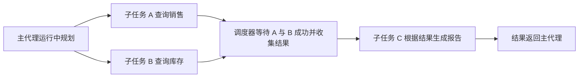
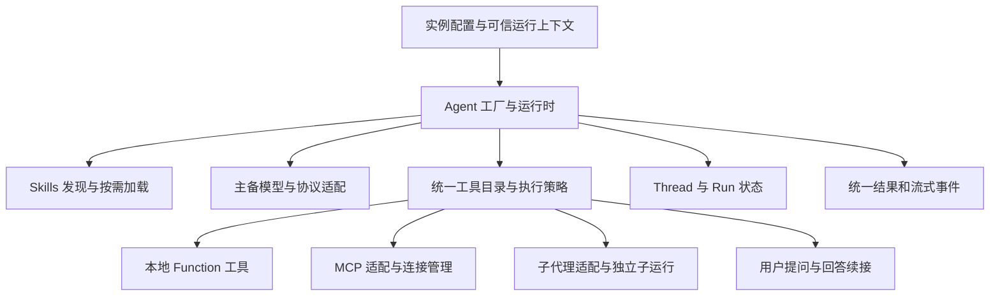

# 通用智能体运行时设计方案

状态：正式运行时方案待确认，业务接入尚未实施；十课完整教程与教学封装已提供并完成本地隔离验证。用户已明确目标是组件式初始化、既可独立运行也可组合为子代理的通用 Agent 运行时，详见[需求文档](./需求文档.md)。

日期：2026-11-13。完整目标设计保留供评审；按用户最新要求一次性提供全部十课，实际学习仍从一个对话实例逐步增加能力，最后封装。各阶段见[首期验证与落地顺序](#首期验证与落地顺序)，全部课程见[学习教程](./学习教程.md)，不代表新增配置已全部确认。

文档归属：本方案及全部课程迁入 `template-agent/.spaces/09.智能体/接口调用智能体/`。新模板的教程命令以项目根目录为工作目录，学习源码计划放在 `scripts/agent-learning/`；原业务项目的规则和模型配置仅作为接入背景引用。本次迁移不实施独立服务或调整包结构。

## 推荐结论

封装方向合理。建议把 Agent 设计成可组合的运行单元，提供稳定、简洁的自身 API；同一 Agent 可以独立执行，也能通过适配成为父 Agent 可调用的能力。先完成一个执行内核及子代理委派方式，避免独立 Agent 与子代理各写一套。

推进方式已明确为先实例、后抽象：先用一个具体实例理解模型及工具的真实运行过程，再逐项增加能力；下文完整配置和 API 是正式运行时草案，课程第十课提供可运行的教学子集。教学路线采用 LangChain JS 的模型与工具接口，涉及编排及暂停恢复时再深入 LangGraph。OpenAI 与 Claude 分别采用 `@langchain/openai` 和 `@langchain/anthropic`，通过一致的 `invoke()` 调用发送消息；固定依赖版本与本地模拟协议已核验，真实供应商行为仍待实际练习。

结合用户提出学习搭建智能体的取向，现行建议以 **LangChain JS** 作为学习与封装底座，先掌握模型／工具循环，再接技能、MCP 和子代理；需要复杂状态恢复与分支时深入 LangGraph。此为当前建议，不代表用户已最终选定框架。首期只实现一个引擎适配。

LangChain 的高层 Agent 已基于 LangGraph；这里的学习顺序是先使用高层接口，再深入状态图、检查点及恢复机制。Agent 业务配置、任务标识和外部事件保留自身接口，具体框架类型集中在适配层。

执行中提问已纳入首期，因此首期也必须验证暂停与续接所需的状态保存；先采用进程内续接状态／检查点，不把跨进程持久恢复作为前提。底层暂停原语、检查点配置及恢复时的重放行为需在实施验证中确定，不能仅凭高层 Agent 接口推定已满足。

Mastra 保留为更重视快速集成现有能力时的候选，替代此前将其作为当前首选的表述。Deep Agents 也是标准技能、文件资料和长任务场景的候选，须核对默认文件能力及工具开放范围。Dify、n8n 保留为可视化平台方向。

## 框架比较与核验结果

| 路线                    | 已核验的匹配能力                                                                        | 本项目仍需封装                                             | 判断                                   |
| ----------------------- | --------------------------------------------------------------------------------------- | ---------------------------------------------------------- | -------------------------------------- |
| Mastra                  | Agent 初始化、内联／目录／动态 Skills、MCP、模型列表 fallback、自定义模型地址与流式执行 | 自身 API、配置解析、宿主权限、隔离、运行事件与真实兼容验证 | 快速集成方向的备选                     |
| LangChain JS／LangGraph | Agent 循环、结构化工具、MCP 适配、模型 fallback 中间件与状态执行                        | 配置层、技能加载组合、执行策略、宿主适配                   | 结合学习目标的当前建议，最终选型待确认 |
| Deep Agents SDK         | SKILL.md 渐进加载、配套文件访问、MCP 与自定义工具                                       | 裁剪默认工具、定义文件区与权限、主备策略适配               | 技能资源与复杂多步任务方向的备选       |
| Dify／n8n               | 可视化应用或流程配置、平台运行与 API 集成                                               | 独立平台部署、配置同步、用户与工具授权映射                 | 真正需要可视化后台或外部自动化时另评   |

Mastra 当前官方配置支持通过 `model` 数组按顺序提供模型，每项可有重试与模型选项；自定义兼容地址的原生字段为 `url`，默认 Chat Completions，另有 Responses 协议选项。自身封装可以采用统一命名，但不能把其字段名误写成官方接口，也不能仅换 URL 就宣称适配所有供应商。

Deep Agents 的 `createSkillsMiddleware` 类型为 LangChain AgentMiddleware，可与高层 Agent 组合，但需配置 backend 与文件读取能力；该中间件本身不提供完整 `read_file` 执行器。backend 可使用线程状态或持久 store，不强制真实磁盘。此组合尚未运行验证。

## 能力范围与配置清单

已明确的目标包括组件式初始化、每实例主备模型／Skills／MCP／工具／提示词、独立执行与子代理复用、执行时确定子任务类型及数量、等待其他子任务后继续，以及执行中提出候选选项供用户选择后续接。用户明确认可 `id`／`description` 与执行限额。其余字段名称、默认值、持久化方式和框架选型仍为建议。

初始化相当于组件的能力配置，执行参数相当于这一次调用的数据。必填项可由可信工厂默认值补足；Skills、MCP、Tools 和子代理目录默认空，不要求每个 Agent 接入所有能力。

| 初始化配置                           | 职责                               | 建议要求                                                               |
| ------------------------------------ | ---------------------------------- | ---------------------------------------------------------------------- |
| `id`、`description`                  | 标识可复用能力，说明适用任务       | 创建时提供；相同目录内的能力名称不得歧义，实例及任务另有运行标识       |
| `systemPrompt`                       | 定义职责、做事方式和回答要求       | 解析工厂默认值后应有明确职责                                           |
| `models.primary`、`models.fallbacks` | 主模型与按顺序尝试的备用模型服务   | 至少一个有效模型，备用列表可空；每项含协议、模型名、服务地址与凭证配置 |
| `skills.directories`                 | 技能发现及按需读取的目录           | 可选；相对路径相对于明确的服务端工作目录解析                           |
| `mcpServers`                         | 外部 MCP 连接与工具发现            | 可选；各服务声明传输、凭证引用、允许工具及是否必需                     |
| `tools`                              | 已注册的本地可执行工具             | 可选；定义输入校验、执行函数及必要的副作用信息                         |
| `subAgents`                          | 预先可复用的 Agent 目录            | 可选；仅注册能力，不预先启动或固定任务数量                             |
| `delegation`                         | 是否开放动态子任务及允许配置的范围 | 可选，默认不开启；启用后可使用模板或受控临时定义                       |
| `inputSchema`、`outputSchema`        | 特定任务的输入输出格式校验         | 可选；普通聊天使用文本输入输出                                         |
| `limits`、`policy`                   | 预算、并发、工具权限及失败处理     | 提供默认值，允许在宿主上限内收紧或覆盖                                 |
| `interaction`                        | 是否允许执行中提问及交互展示约定   | 首期支持；提问次数、有效期、宿主接收方式可配置；缺少交互通道时明确返回 |
| 历史存储适配                         | 保存连续会话                       | 建议首期进程内实现；持久化需明确配置，字段在契约阶段确定               |

| 单次执行参数 | 职责                               | 建议默认                                   |
| ------------ | ---------------------------------- | ------------------------------------------ |
| `input`      | 本次任务，文字或符合 schema 的对象 | 必填                                       |
| `threadId`   | 需要接续的会话编号                 | 可选；不传则新建独立会话，传入时先校验归属 |
| `context`    | 本次业务信息与宿主验证的调用上下文 | 可选；不自动复制到模型提示词               |
| `signal`     | 调用方取消信号                     | 可选；仍受运行时截止时间约束               |

## 对外 API 建议

以下为本项目拟封装的调用形式，不是已存在代码，也不是 LangChain 或 Mastra 的原生构造参数；正式类型和字段在技术契约阶段确定。

```typescript
const reportAgent = await createAgentRuntime({
  id: 'report-agent',
  description: '查询报告所需数据并生成报告。',
  systemPrompt: '根据工具返回的真实数据生成报告。',
  models: {
    primary: primaryModel,
    fallbacks: [backupModel],
  },
  skills: { directories: ['./skills/report'] },
  mcpServers: [reportMcpServer],
  tools: [queryReportTool],
  limits: { maxSteps: 8 },
})

const result = await reportAgent.run({
  input: '生成本月报告',
  threadId: conversationId,
  context: trustedExecutionContext,
  signal: abortSignal,
})

const coordinator = await createAgentRuntime({
  id: 'coordinator',
  description: '拆解任务并汇总已注册子代理的结果。',
  systemPrompt: '按任务需要委派，基于子代理真实结果回复。',
  models: defaultModels,
  subAgents: [reportAgent.asSubAgent()],
  delegation: { enabled: true },
})
```

上述变量由调用方在服务端提供；模型配置包含协议／provider、模型 ID、服务地址及受控凭证引用。`maxSteps` 仅为形态示例，实际限额须验证。

`asSubAgent()` 返回调用适配，不修改 `reportAgent` 的配置或已有对话。父 Agent 委派时为它建立新的子 run，完成后返回结果；独立调用 `reportAgent.run()` 仍可使用。新建其他独立 Agent 继续使用相同工厂和显式配置，不默认克隆运行历史。默认模型可由工厂提供，实例配置按明确规则覆盖。

建议补充可选的 `inputSchema`／`outputSchema`、执行策略、运行限制和事件接口。它们解决组合时的输入输出、上下文和资源边界，并不要求调用方每次初始化都填写全部高级选项；列表默认空、运行限制提供合理默认，模型则须在解析工厂默认值后仍有有效配置。

对外方法建议如下：

| 方法                          | 行为                                                     |
| ----------------------------- | -------------------------------------------------------- |
| `createAgentRuntime(config)`  | 校验并解析定义，初始化能力目录及必需资源                 |
| `agent.run(params)`           | 启动一次执行，返回最终结果或需要用户输入的非终态响应     |
| `agent.stream(params)`        | 启动一次执行，输出过程事件，到终态或用户提问边界交回控制 |
| `agent.resume(params)`        | 提交对应交互答案，续接原运行，返回终态或下一交互边界     |
| `agent.resumeStream(params)`  | 以流式方式提交答案并续接原运行，与 resume 二选一         |
| `agent.getRunSnapshot(runId)` | 查询可访问运行及本次树中的待答问题，不启动或重跑任务     |
| `agent.asSubAgent()`          | 取得可委派的调用适配，保持原实例可独立执行               |
| `agent.close()`               | 结束本实例的调度及按所有权释放资源                       |

`run` 与 `stream` 是两种启动方式，调用方选择其中一种；先 `run` 再 `stream` 会创建两次任务，不能用这种方式订阅同一次任务。单次执行可通过 `signal` 取消；远程取消入口后续由宿主按 runId 与归属校验适配。

`resume` 与 `resumeStream` 是同一次暂停任务的两种恢复方式，不能对同一交互各调用一次。上例中的 result 因此需要区分终态结果与需要用户输入的响应；不能在收到提问后直接当作报告内容。具体响应字段见下文交互草案，均为待评审的自身 API。

初始化完成静态校验、技能目录建立与所需连接。必需 MCP 连接失败应明确报错；可选 MCP 可按配置降级并报告不可用能力，不把未成功发现的工具伪装为可调用。`close()` 的建议行为是拒绝新任务，取消本实例仍活跃的任务，等待有限的清理时间后释放拥有的资源；借用的子 Agent 不随之销毁。

代码初始化可以传入已注册的工具对象与执行函数。若需要保存为 JSON 或开放配置界面，应使用 tool ID、skill ID、MCP 配置引用和 credential reference，再由后端注册表解析；不在 JSON 中存放可反序列化执行的 JavaScript 函数。

### 配置含义与默认用法

用户已认可 `id`／`description` 和 `limits`，其余条目目前为设计建议；以下说明不代表强制每次初始化全部填写。

- `inputSchema`／`outputSchema` 是输入及输出的可校验格式，类似组件 props 或函数参数与返回值约定。例如报告输入为 `{ month: '2026-11' }`，输出为 `{ summary: '…', total: 100 }`，校验器检查月份与金额类型。普通聊天可直接接受字符串并返回文本，不要求每个任务提供专用 schema；TypeScript 类型本身不能保证模型实际返回的数据合格。
- `subAgents` 可作为已有 Agent 能力或模板的目录，供运行时选用，不表示初始化时启动全部实例，也不表示固定并发数量。动态创建方式见下节。
- `threadId` 标识一次连续对话，类似聊天窗口的会话编号；配置历史存储并校验归属后，相同编号才能接续相同会话。独立任务可以不传；编号本身不会自动提供历史或授权。
- `context` 为这次执行额外携带的业务信息，例如目标月份、工作空间、语言，以及由宿主验证的调用者身份。工具可从受控上下文取值；仅必要的业务信息映射给模型，不将整个上下文或凭证注入提示词。此参数可在每次 run 变化，避免把实例绑定到某位用户。
- `policy` 是执行器实际检查的规则，例如只开放查询工具、禁止删除、仅对适宜重试的查询重试、指定写入工具按业务要求确认。可有默认值，并与已有工具元数据及宿主权限衔接；不应机械地为所有写操作强制交互确认。
- 事件相当于组件的回调或订阅：文本增量用于边生成边展示，工具／子任务开始及结束用于进度，失败事件用于展示错误。生命周期区分初始化、运行、取消及实例关闭；取消本次 run 不等于销毁可复用 Agent，关闭实例时按所有权释放 MCP 连接或所启动的进程。
- `interaction` 负责“有歧义时先问用户再继续”：AI 生成问题和选项，宿主展示，用户回答后续接原运行。它与输入输出 schema 分别处理任务中的澄清和任务整体的数据格式；澄清回答也不自动等同于操作授权。

## 四个对象与生命周期

| 对象            | 保存什么                                   | 隔离规则                                              |
| --------------- | ------------------------------------------ | ----------------------------------------------------- |
| AgentDefinition | 提示词、模型策略、技能和工具引用、配置版本 | 表示可复用定义，不保存某位用户的聊天历史              |
| AgentRuntime    | 已解析的框架实例、模型客户端和资源句柄     | 可复用受控连接，不混用凭证或可写状态                  |
| Thread          | 某个用户／作用域的对话与必要状态           | ID 不代表授权；同一 thread 并发须串行或做版本冲突处理 |
| Run             | 一次任务的输入、事件、步骤、工具结果及终态 | 每次独立上下文、预算、取消信号和运行标识              |

配置更新对新 run 生效，执行中的 run 固定定义版本；权限仍需实时检查。实例复用不等于线程状态共享，凭证、文件区和可写数据必须明确归属。

`id` 是能力定义在其注册目录内的名称，不能替代一次执行的唯一 `runId`。同一份定义可创建多个实例，每次执行仍有独立 runId；同一 thread 首期建议串行执行，避免两次响应同时改写历史。历史按模型容量选择近期消息及明确摘要，工具长结果做受控裁剪或返回产物引用；保留历史不等于无限塞入提示词。

### 子代理组合、继承与委派

父子关系属于本次调用的 run 链，不是将 Agent 实例永久改成某个父实例的附属对象。记录 rootRunId、parentRunId、子 runId 及 Agent 配置版本；同一个 Agent 可被多个父运行复用，但每次使用独立状态和可信上下文。

初始化可注册已有实例，也可提供允许实例化的能力模板／工厂；`subAgents` 不是必须填满的固定团队。执行时由模型规划或代码选择任务，再由运行时创建相应 child run。同一个资料查询模板可以按需求启动两个或更多独立任务，实际数量由本次任务及预算共同决定。

允许执行中临时生成角色时，模型可提出职责、提示词及可开放范围内的工具／技能引用；具体模板、可覆盖项与允许的模型／MCP 配置由可信工厂验证。动态创建不授予模型任意启动进程、指定凭证或扩展权限的能力。是否同时支持预设角色与临时角色，以及最终字段命名仍待确认。

建议 `delegation.enabled` 控制是否向模型开放创建与等待工具。预注册子 Agent 使用自己的定义；临时定义未指定模型时可采用父任务允许的默认模型，工具与技能从明确开放的能力池中选择。只传本次委派任务及必要上下文，默认不继承完整历史，也不复制凭证。新建完全独立 Agent 继续走 `createAgentRuntime`，不会自动归入当前父 run 或复制其状态。

首期建议采用“父 Agent 发出任务 → 子 Agent 执行 → 返回结果 → 父 Agent 继续”的委派方式，可适配为受控工具，并保留按任务标识等待及汇合的调度能力。父模型根据子代理 description 选择能力，也可由代码显式委派；是否两者都开放待确认。整段对话控制权转交属于不同语义，不与普通子代理调用混为一谈。

子代理仅接收明确任务、必要上下文和受控引用，默认不复制父 system prompt、完整历史、全部 Skills、Tools 或 MCP 凭证。自己的模型／主备策略及能力目录可以独立配置；有效权限须同时满足可信调用者授权、当前委派范围和子代理执行策略。

返回值建议包含可校验的数据、摘要或产物引用以及明确状态，父运行不必接收子代理完整内部消息。工具调用成功与子任务成功分别记录，超时、取消和输出 schema 不合格不能作为成功答案交给父模型。

需补充整棵调用树的总步骤、总耗时及用量预算，并限制最大深度、子任务数量和并行数。检查直接／间接循环委派，动态创建也受深度与预算约束；子 run 的重试与备用模型尝试均消耗同一总预算。

父取消传播到其子 run，但不能取消同一实例处理的其他独立任务。远端已提交动作不因终止父 run 而回滚。子任务失败默认明确返回失败，由父任务策略决定终止或继续；涉及副作用时不能无条件自动重试整个子任务。

调用方传入的已初始化子 Agent 默认视为借用，父 `close()` 不自动销毁它；由父运行时根据定义创建并拥有的子资源才随其释放。正在使用的共享 MCP 连接须有所有权／引用管理，不能因一次子运行结束被提前关闭。

### 通信、等待与任务依赖

建议第一期由运行时／父调度器传递任务和结果。子代理有独立历史，彼此不会自动看到对方的消息。先通过任务标识记录状态及结果，再由调度器把完成的结果传入需要它的下一任务；大结果可传受控文件或产物引用。

例如主代理执行后决定并行启动 A 查销售、B 查库存，再由 C 基于两份结果生成报告：



这个依赖也可以表现为 C 已运行，随后发现需要 B 的结果并请求等待：运行时验证可访问的目标 run，暂停 C 后续调度；B 到达终态后，将结果或失败原因作为工具结果交回 C，再继续模型调用。等待期间不需要持续调用模型询问进度；实际已发出的其他调用仍按自身生命周期处理。

在同一 Node.js 进程内，等待可由 Promise 与任务结果表实现，不占住 JavaScript 线程；若要求进程重启后或跨进程继续，则需持久状态与可靠通知／检查点，不能宣称普通 Promise 已提供该能力。

协调能力统一采用以下草案名称，不是已实现接口或 LangChain 原生 API。模型通过注册工具调用它们，程序调用也走相同的任务调度与权限检查。

| 协调能力           | 行为                                                       | 首期建议                                         |
| ------------------ | ---------------------------------------------------------- | ------------------------------------------------ |
| `spawnAgent`       | 根据已有 Agent、模板或允许的临时定义启动任务，返回任务句柄 | 提供；完成创建／排队即返回，不等待任务结束       |
| `waitFor`          | 等待指定 taskId，返回终态、结果或失败原因                  | 提供                                             |
| `waitAll`          | 收集多个 taskId 的终态与结果                               | 提供；失败也要返回，后续任务检查所需结果是否成功 |
| `getResult`        | 读取可访问任务的当前状态及已有结果                         | 提供；不以高频轮询替代等待                       |
| `cancelTask`       | 请求取消本次授权范围内的任务                               | 提供；不能借 Agent 名称取消该实例的其他任务      |
| `requestUserInput` | 提出澄清问题及候选项，等待用户回答后返回对应工具结果       | 提供；主／子运行均可使用，由宿主统一展示及路由   |
| `sendMessage`      | 向指定任务投递补充消息                                     | 可选扩展；投递不等于处理完成或任务完成           |

任务句柄中的 taskId 对应一个 child runId，不使用可复用 Agent 的 id 作为等待目标。队列、等待与结果读取都要校验同一调用树及显式授权范围。等待期间的父任务或子任务应释放活跃执行名额，避免所有并发名额被等待者占据，导致真正需要执行的任务无法启动。

完成状态与结果必须由运行时记录。等待后完成或先完成再等待都应可读取相同终态；等待超时、目标失败／取消、A 等 B 同时 B 等 A 等情形需要明确返回，不用不受控重试或无限等待掩盖。执行依赖与直接／间接委派环分别检查；有效依赖不要求父子任务共享完整聊天记录。

首期默认不运行脱离父任务的后台子任务：父运行完成、失败、取消或总截止时间到达时，清理本次调用树尚未结束的子运行。需要后台长期任务时，应另设计持久调度、所有权和结果领取方式。

## 执行中澄清：提问、选择与续接

这是用户明确要求加入首期的能力。模型识别多个合理解释或缺少会影响任务结果的条件时，调用受控的 `requestUserInput` 协调工具，将判断交给用户；无法从上下文确定时才问，避免对已明确条件重复提问。它支持文字说明、候选选择及自由文本补充，不要求问题都预先写死。

例如用户说“生成本月报告”，界面可展示：

> 你需要哪种报告？
>
> - 销售报告：统计销售额、订单和趋势。
> - 库存报告：统计库存余量和缺货情况。
> - 综合报告：同时汇总销售与库存。
>
> 也可以补充其他要求。

用户选择“综合报告”后，继续原运行，再决定是否创建销售／库存子代理；不能在答案到达前按任意候选执行依赖该选择的操作。推荐项或预选项不代表已经收到用户回答。

### 问题与答案的关联

以下为设计草案，不是正式 DTO；名称、数量上限和可选字段在实施契约中确定。

| 信息                                | 用途与边界                                                                   |
| ----------------------------------- | ---------------------------------------------------------------------------- |
| `interactionId`                     | 运行时生成的交互唯一标识，关联一次提问、回答与续接，防止重复恢复             |
| `rootRunId`、`runId`、`parentRunId` | 标明所属调用树及实际提问的主／子运行；界面无需取得子代理内部历史             |
| `questions`、`questionId`           | 问题正文及批次内稳定标识，答案必须对应本次要求回答的问题                     |
| 选项 `id`、`label`、`description`   | 用稳定 ID 接收选择，标签说明候选解释；首期默认单选，允许文字补充或自定义回答 |
| `expiresAt`                         | 问题有效期，展示及提交均以运行时记录为准；模型不能自行延长                   |
| `answers`                           | 用户明确提交的选项 ID／自定义文字，由运行时校验后作为该协调工具的结果        |

一次批次的必答项齐全且合法后才恢复该续接点；不匹配的选项或缺失回答明确返回校验问题，不自动修正成模型猜测。自由文本可以表达不同于全部候选的要求，模型收到后仍可在限额内提出下一轮必要澄清。多个子任务可以各自提出问题，宿主按来源及 interactionId 展示并分别提交，不能把一个答案广播给所有等待者。

### 如何把控制权交回界面

1. `run` 启动后，主／子运行提出问题时，运行时保存问题、已完成步骤及续接位置；提问者进入 `waiting_for_user`，释放活跃并发名额。
2. 普通调用返回需要用户输入的非终态响应，包含当前 run 标识、问题来源及待答交互；流式调用发出 `input_required` 并结束本次事件迭代，将控制权交回宿主。暂停不等于完成，不触发调用树清理。
3. 宿主显示问题，用户提交后调用 `resume` 或 `resumeStream`，携带目标 runId、interactionId、对应答案及宿主重新验证的调用上下文。它们续接原 run，保留相同 runId、历史及已消耗预算；不会再次调用 `run` 创建任务。
4. 运行时先校验归属、问题状态、答案和当前权限，再记录答案并恢复对应协调工具结果；执行返回终态或下一次提问。并发提交按单次消费处理，重复提交返回已处理状态，不重复运行后续步骤。
5. 其他无依赖子任务可继续；依赖提问子任务的父运行可以处于 `waiting`，实际提问的子运行处于 `waiting_for_user`，响应同时保留这些真实状态。多个问题或后续事件通过 `getRunSnapshot` 查询，运行驱动需串行化，不能因两次恢复并行改写同一状态。

这里结束的是一次 API 响应／事件迭代，不是结束 run。客户端连接断开也不隐含取消，取消由显式取消入口或 signal 约定触发；适配层不能把每次 HTTP 响应结束直接映射成运行取消。同进程内查询待答问题及结果使用内存状态表，初版不承诺事件重放或进程重启后的找回。

无法展示交互的调用方应识别需要用户输入的响应；明确禁用交互的调用返回不支持交互的错误。不能让服务端一直挂着 HTTP 请求或默默替用户选择。澄清的选项与业务写入确认分别建模，即使复用同一展示组件，回答一个报告类型问题也不等于授权执行写入。

### 状态保存、等待时限与异常

- 提问与恢复至少需要进程内续接状态，不能仅把问题打印成一条聊天文本。若使用框架检查点，需要验证恢复执行范围；提问前的副作用安排在独立已记录步骤中，工具结果及幂等记录不能因节点重放丢失或重复执行。教学子集已验证原图／子图暂停恢复，详见[验证记录](./验证记录.md)；正式业务副作用与持久恢复仍需专项验收。
- 等待期间不持续请求模型，也不占活跃运行名额。整棵调用树仅剩用户等待及其依赖等待时，暂停执行耗时计量；仍有其他可执行、排队或进行中的任务时继续计量，避免一个子任务提问让其他任务无限执行。
- 单个问题有固定有效期，整树还有累计用户等待预算和提问次数上限。回答不重置模型／工具次数、执行剩余时间或用户等待预算；宿主设定的绝对截止时间仍生效。交互到期使提问运行进入 `timed_out` 并通知依赖者；父运行按失败策略处理，整树预算耗尽则终止根运行。
- 问题过期、运行取消／终结、权限失效时拒绝恢复；取消传播到待答问题并使其失效。超时、默认项或连接断开都不构成用户答案。
- 日志与事件只暴露调用者可见的问题、选项和来源；回答受同一用户／作用域及对话数据边界保护，不能凭 interactionId 绕过鉴权。

## 内部职责



### Skills

Skills 提供任务知识、做法和参考文件，Tools 提供可执行能力，两者分别管理。先加载名称和描述，按任务需要读取技能正文及参考资料，避免每次将全部技能内容放入提示词。

优先复用所选框架的原生技能机制，再确认标准 SKILL.md 兼容范围。技能声明依赖某个工具时，仍须经过工具目录和执行策略检查；缺失依赖须清晰反馈。技能文档与工具返回数据不能提升平台权限，随附脚本不因读取技能而自动执行。

实例的 system prompt 定义任务职责；平台执行策略独立于提示词，必须在实际执行器中约束。不同提供商对消息角色的映射由模型适配层处理。

### 本地函数与 MCP 工具

本地 function 与 MCP tool 统一形成模型可见的工具目录，保留来源、输入 schema、输出规范和副作用标记。工具名称采用来源命名空间或显式冲突拒绝策略，避免 MCP 工具覆盖本地函数。

function calling 是模型输出工具请求的协议；真正执行由本地函数执行器或 MCP 客户端负责，不能把模型输出视为已经完成的操作。

MCP 连接管理包括连接、发现、过滤、调用、断线处理和释放。可按相同配置与凭证作用域复用连接，不能仅按 URL 全局缓存。请求级凭证与授权工具集由宿主上下文解析，不能因初始化缓存一次工具列表而冻结权限。

远程 HTTP 与本地 stdio 分别建模；stdio 的进程命令仅能来自可信服务端配置。MCP 的 prompts／resources 是否开放另行定义，接入 tools 不代表默认开放全部能力。共享连接以清晰的所有权或引用管理释放，关闭一个实例不能误关其他运行的连接。

工具调用需要输入校验、执行前策略、超时、输出裁剪与错误映射。通用核心接受策略 hook，具体用户、租户和业务权限由宿主适配；有副作用的工具按业务配置确认、幂等和审计。

### 主备模型

主备模型分别描述协议／provider、模型 ID、服务地址、凭证引用、优先级及模型选项。初始化或上线验证时核对 tool calling、schema、结构化输出、上下文容量与流式能力；支持聊天并不代表支持当前 Agent 任务。

按配置对超时、限流、暂时性服务故障做有限重试和 fallback。鉴权、配置错误与不兼容请求应明确报错，不默认无限轮换掩盖故障。所有模型尝试共用本次 run 的总耗时与重试预算。

fallback 作用于模型生成步骤，保留已经成功的工具结果和执行记录，不重跑整个 Agent。模型输出的工具请求须完整解析和校验后才能执行。写入工具结果不明时先查询状态，不能靠换模型解决重复执行问题。

已经输出部分文本后再切换模型，应发出明确的重试／尝试事件并定义替换或结束行为，不能把两个模型的半段回答直接拼成一个成功结果。具体流式规则需在技术契约及真实模型验证中确定。

### 运行状态、限制与事件

对外保留自己的输入、结果和事件形态，框架事件由适配层映射。建议覆盖文本增量、技能加载、工具开始／结果、子运行开始／结束、模型切换、用户提问／回答／续接／过期、业务确认、完成、取消和失败；父子事件通过 run 标识关联，字段尚未定稿。用户交互事件草案为 `input_required`、`input_received`、`run_resumed`、`input_expired`，无效答案不发出成功恢复事件。

每个 run 设置最大步骤、工具超时、总耗时、重试预算和取消信号。取消后停止调度新模型与工具请求，并尽力中止正在进行的调用；远端已有副作用或不能中止的执行须记录真实状态，不能声称已经撤销。

持久化需要单独配置与验证，不能把框架支持 Memory／Storage 当作进程重启后自然可恢复。首期 thread 与提问续接状态在进程内保存，并验证恢复步骤及副作用记录；持久检查点、跨进程恢复和长期幂等记录另行设计。

## 结果、事件与建议默认值

一次 run 以 `completed`、`failed`、`cancelled` 或 `timed_out` 结束；执行中可区分 `queued`、`running`、`waiting`、`waiting_for_user`。`waiting` 表示等待任务结果，`waiting_for_user` 表示等待本运行提出的问题答案；它们均为非终态。结果建议统一包含 runId、parentRunId、状态、成功输出或明确错误，以及步骤／模型用量等统计。`outputSchema` 不合格时按失败或有限修复策略处理，不能只返回任意文本并标记成功。

事件以 runId、parentRunId、事件类型和时间关联；用户交互另含 interactionId。文本增量用于即时显示，技能／工具／子任务事件用于进度，模型切换用于说明生成尝试变化；终态事件携带同一次 run 的最终结果。`run()` 和 `resume()` 返回终态结果或需要用户输入的非终态响应，调用方据此显示答案或问题，不依赖框架内部消息格式。非终态响应中保留各实际运行状态及待答问题；同进程内可按归属查询快照，初版不承诺断线后事件重放、跨进程结果领取或重启恢复。

以下是用于评审的初始默认值，尚未实现或验证，均可按实际任务调整。限额由宿主和实例共同约束，子任务只可在剩余总预算内执行。

| 项目                   | 建议初值／行为                         | 计量范围                                                                                     |
| ---------------------- | -------------------------------------- | -------------------------------------------------------------------------------------------- |
| `maxSteps`             | 20                                     | 每个 run 的模型决策轮数；调用一次工具后再请求模型属于下一轮                                  |
| `maxTotalModelCalls`   | 40                                     | 整棵调用树的实际模型请求次数，包含重试及备用尝试                                             |
| `maxTotalToolCalls`    | 80                                     | 整棵调用树的本地／MCP 工具实际执行次数，包含重试；协调工具另受模型轮数及子任务限额约束       |
| `maxChildRuns`         | 8                                      | 根任务下累计创建的子任务，包含后代                                                           |
| `maxConcurrent`        | 3                                      | 同一调用树的活跃运行名额，等待者释放名额                                                     |
| `maxDepth`             | 2                                      | 根为第 0 层，最多到孙代理                                                                    |
| `timeoutMs`            | 120000                                 | 整树执行时限，含排队、任务依赖等待；整树仅因用户回答等待而暂停时停止计量；子任务共享剩余预算 |
| `toolTimeoutMs`        | 30000                                  | 单次工具调用，上限还受任务剩余时间约束                                                       |
| `interactionTimeoutMs` | 1800000                                | 单个问题自提出起 30 分钟有效，不因界面重连或其他答案延长                                     |
| `maxTotalUserWaitMs`   | 1800000                                | 整树因等待用户而暂停的累计时长上限，重叠等待只计一次，不逐轮重置                             |
| `maxUserInteractions`  | 8                                      | 整树累计创建的有效提问批次，包含主／子代理                                                   |
| `deadlineAt`           | 宿主可指定的绝对截止时间               | 不因暂停或续接延后，与执行及用户等待预算同时约束                                             |
| 用户交互               | 支持单选及文字补充                     | AI 提问，宿主展示并明确提交；首期进程内暂停续接，字段与默认值待评审                          |
| 普通聊天 schema        | 文本输入输出                           | 专用输入输出格式按需启用                                                                     |
| 动态委派               | 默认关闭，协调 Agent 显式开启          | 与允许的模板、能力池和范围检查共同生效                                                       |
| 工具策略               | 执行前校验参数、身份、权限和有效作用域 | 额外交互确认只对业务指定工具启用；不默认重试写入动作                                         |
| 会话／任务存储         | 进程内隔离保存                         | 不承诺重启恢复、跨进程协作和长期记忆                                                         |

`policy` 可复用宿主鉴权及工具注册信息，不强制独立配置复杂规则系统。模型可恢复故障按有限预算重试或切备用；参数错误、无权限、不可恢复配置错误要明确返回。所有超时和取消仅能停止后续调度并尽力中止正在进行的请求，不能撤销已经发生的远端动作。

## 一次完整执行路径

1. 宿主初始化 Agent：解析默认值与实例配置，校验模型能力，发现技能、工具及 MCP，建立子代理能力目录。
2. 调用方提交 input 与可选 threadId／context／signal；运行时校验归属，创建根 runId、执行／用户等待预算及可选绝对截止时间。
3. 模型依据提示词、必要历史和按需加载的技能做决策：直接回答、调用本地／MCP 工具、提出子任务，或请求用户澄清。
4. 调度器校验子任务能力与预算，按本次计划创建实际数量的 child runs，分别管理状态。
5. 无依赖的子任务可并行；需要其他结果的任务进入 waiting，结果就绪后由运行时恢复后续执行。
6. 主／子运行需要澄清时进入 waiting_for_user，保存续接状态并交回问题和选项；用户回答经归属、格式、有效期与权限校验后恢复原运行，其他无依赖子任务可继续。
7. 每次模型故障按策略尝试备用，保留已完成工具结果；每次工具执行仍检查实时权限。
8. 校验最终输出，返回明确终态和统计；流式调用同步返回过程事件。仅在终态清理本次任务的未完成子运行及交互，长期资源由实例生命周期管理。

## 与当前项目的边界

通用核心应通过 TypeScript 模块或类组织，不依赖具体 Controller、组织、项目或岗位实体；若需要独立 HTTP 服务，可由 NestJS 提供生命周期、依赖注入、会话权限和对外接口适配。核心库、服务入口与 playground 的 monorepo 分包方式仍属讨论建议，本次迁移不创建对应实现。

原业务项目的[共享代码规则](../../../../template-vp-monorepo-react-nestjs/.agents/rules/共享代码.md)仅作为未来接入该项目时的约束背景，其中 `packages/shared/src/types` 与 `packages/shared/src/utils` 不代表新模板已有这些实现目录。新模板的包结构、导出边界及共享契约在实施时明确；模型 SDK、MCP 客户端和凭证应在 Node.js 环境运行，不直接进入浏览器。

原业务项目的[模型配置](../../../../template-vp-monorepo-react-nestjs/apps/server/src/config/llm.config.ts)仅作为历史接入参考，不是新模板的配置入口，也不代表供应商协议已经验证。新模板使用课程中的独立模型环境配置；未来实例传入的受控配置按明确优先级覆盖，不能通过改全局环境变量为每个实例换模型。

未来接入原业务项目的 Service 时，由适配层保留参数校验、有效 Session、实时权限、资源归属与公开输出；直接调用 Service 不会自动执行 Controller Guard、Pipe 和响应拦截器。通用运行时本身不绑定该产品的登录方式。

## 首期验证与落地顺序

第一期建议交付：代码配置初始化、独立执行、Skills／MCP／Tools、主备模型、可选结构化输出、进程内会话隔离、预注册 Agent 复用、受控动态子任务、等待及并行汇合、执行中提问及选择／文字回答后续接、事件／取消、资源管理和整树限额。

后续扩展：代理直接消息、持久会话、跨进程任务恢复、后台长期任务、长期记忆、可视化配置、对话控制权 handoff。上述能力分别评估，不以采用某个框架推断已经支持。

用户选择从一个实例递进学习，最后再封装，并已确认由用户亲手编写、助手逐步讲解及检查结果。现按最新要求一次性交付[全部十课教程](./学习教程.md)，每课提供新增概念、完整代码、运行方法、观察点与练习；用户实际编写和验收仍按阶段进行。完整首期目标由这些阶段共同组成，教学封装与正式产品运行时分别记录。

| 阶段                | 在同一实例上增加什么                                        | 练习与通过标准                                                                                                                     |
| ------------------- | ----------------------------------------------------------- | ---------------------------------------------------------------------------------------------------------------------------------- |
| 1. 最小对话         | OpenAI／Claude 各一个模型客户端、一次用户输入、一次回复     | 分别执行两个后端脚本并打印模型回复；能分清协议、模型地址、模型名、凭证和输入输出；先认识模型调用，此时还没有自主工具执行           |
| 2. 提示词           | system／user 消息与参数模板                                 | 固定助手职责、更换本次问题，观察回答差异；理解第一步的用户消息已经是 user prompt，系统指令不等于权限                               |
| 3. Function calling | 本地工具定义、输入 schema、真实执行及结果回传               | 用一个无副作用的计算或查询工具观察调用参数、程序结果与最终回答；先讲清调用循环，再交给高层 Agent 管理，带步骤上限                  |
| 4. Skills           | 技能目录、名称／描述发现、按需读取正文                      | 让实例按任务加载一个 SKILL.md 并应用做法；工具中显式实现读取及路径边界，传入目录不会自动获得技能能力，读取技能也不自动执行随附脚本 |
| 5. MCP              | 外部 MCP 连接、发现工具、适配到现有目录                     | 接入一个授权查询工具，核对与本地工具的调用来源、命名和连接关闭；传输方式及真实服务在该阶段确定                                     |
| 6. 会话             | 消息历史、threadId、进程内存储与上下文隔离                  | 上一轮说明一个条件，下一轮能引用；新会话不能读到旧历史；理解模型不会自行记忆本地没有传入的消息                                     |
| 7. 编排             | 单个 Agent 内的明确步骤、状态及条件分支                     | 按“查询数据 → 整理 → 回答”完成任务，观察状态传递；此时先学习单任务步骤编排，后续再组合多个代理的结果依赖                           |
| 8. 打断交互         | 问题、候选项、用户回答及暂停续接                            | 歧义任务给出选项，用户选择或补充后接着同一 run 执行；未答不继续依赖步骤，暂停不调用模型，恢复不重做已完成工具                      |
| 9. 子代理           | 先委派一个已有 Agent，再受控动态创建与并行等待              | 子运行有独立输入和状态；执行时决定数量，验证 A／B 并行后 C 汇合、先完成再等待、失败／取消传播和子代理提问路由                      |
| 10. 最终封装        | 从实例提炼配置、工厂、run／stream、resume、close 等稳定接口 | 第二个实例只更换配置即可执行另一任务；原有技能／工具／会话／交互／子代理能力不丢失，运行状态及凭证隔离                             |

流式输出、主备服务、取消、超时与用量统计随阶段补齐：模型对话稳定后加入流式及有限 fallback，工具阶段加入参数校验与执行限额，会话／编排阶段加入 run 状态和取消，打断及子代理阶段补齐整树预算与恢复规则。每个阶段先保证小例子可运行，不提前要求全部高级配置。

第一阶段在 `template-agent` 根目录运行独立 Node.js 学习脚本，位置为 `scripts/agent-learning/`，两个同功能文件集中在该目录；创建前读取所在目录规则。使用 `.mjs` 让 Node 直接执行 ESM 和顶层 `await`，暂不增加 TypeScript 运行器。OpenAI 使用 `OPENAI_API_KEY`／`OPENAI_MODEL`，Claude 使用 `ANTHROPIC_API_KEY`／`ANTHROPIC_MODEL`，可选自定义地址分别使用 `OPENAI_BASE_URL`／`ANTHROPIC_BASE_URL`。变量放在根目录本地 `.env.agent.local`，由 Node 的 `--env-file` 读取；目标模板的 `.env.*` 忽略规则覆盖该文件。原业务项目的 `LLM_API_URL`／`LLM_API_MODEL`／`LLM_API_KEY` 不作为这里的前置配置。示例不进入浏览器，不要求启动完整 NestJS、数据库或 Redis。代码由用户按[学习教程](./学习教程.md)亲手编写。业务目录尚未生成脚本或安装依赖；课程示例在隔离目录提取验证，结果见[验证记录](./验证记录.md)。

第一课先讲清三个操作：创建模型客户端、`invoke` 发送一次用户消息、读取回复中的 `content`。客户端是服务调用对象，不是本地加载了模型权重；异步调用会实际请求模型服务；回复是消息对象而不只是字符串，`content` 可能是文本或内容块。两协议已明确，具体模型 ID 由用户填写账户可用值；教程给出匹配的安装、初始化与运行命令，不要求用户在聊天中发送密钥。自定义地址必须与适配器协议一致，地址填写服务基础地址，不填写完整的 `/chat/completions` 或 `/messages` 端点。

正式运行时验收仍需覆盖：两个配置／会话／凭证作用域隔离、输出校验、主备切换不重复工具、MCP 断线与关闭清理、子运行依赖环及资源所有权、重复／过期／越权交互提交、等待计时、同进程断线后查询，以及检查点重放边界。涉及当前产品的使用方，再补 NestJS 接口和权限适配；每阶段记录实际验证，不能把规划写成已经通过。

当前交付范围为完整十课资料及其核验说明；示例按功能集中于课程中，通过学习入口导航。业务目录不自动生成脚本或运行时代码，不调用真实付费模型、不部署社区平台；隔离环境中的示例核验以教程的实际验证记录为准。正式 DTO、存储、UI 与产品测试仍待相应实施任务建立。

## 官方参考与核验边界

2026-11-13 补充核验第一课的 [LangChain OpenAI](https://docs.langchain.com/oss/javascript/integrations/chat/openai)、[LangChain Anthropic](https://docs.langchain.com/oss/javascript/integrations/chat/anthropic)及 [OpenAI 快速入门](https://developers.openai.com/api/docs/quickstart)。依赖版本、Node 要求、模型适配器及可选基础地址说明集中记录在[学习教程](./学习教程.md)。本次另外完成本地隔离验证，见[验证记录](./验证记录.md)；未调用真实付费模型，也不扩大下列既有方案的验证范围。

2026-11-10 核验当前官方文档；以下结论是文档核验，尚未完成运行时兼容测试：

- [Mastra Skills](https://mastra.ai/docs/skills)：内联、目录与动态技能、技能发现和读取工具。
- [Mastra MCP](https://mastra.ai/docs/connections/mcp)：工具发现、请求级工具集、凭证与连接生命周期。
- [Mastra Models](https://mastra.ai/models)：模型列表 fallback、自定义 URL／协议与提供商适配。
- [Mastra Streaming](https://mastra.ai/docs/guides/streaming)：流式调用、文本及完整事件流。
- [Mastra RequestContext](https://mastra.ai/docs/server/request-context)与[Storage](https://mastra.ai/docs/storage)：请求上下文与存储边界。
- [LangChain JS 概览](https://docs.langchain.com/oss/javascript/langchain/overview)、[MCP](https://docs.langchain.com/oss/javascript/langchain/mcp)及[内置中间件](https://docs.langchain.com/oss/javascript/langchain/middleware/built-in)：Agent、MCP 与 fallback 等能力。
- [Deep Agents Skills](https://docs.langchain.com/oss/javascript/deepagents/skills)、[概览](https://docs.langchain.com/oss/javascript/deepagents/overview)与[Skills 中间件参考](https://reference.langchain.com/javascript/deepagents/middleware/createSkillsMiddleware)：标准技能、backend 及中间件组合边界。
- [Dify](https://github.com/langgenius/dify)与[n8n](https://github.com/n8n-io/n8n)：可视化平台定位参考。

## 变更记录

2026-11-13：按用户要求迁入 `template-agent/.spaces/`，同步教程路径、项目边界、历史关联引用与导航；保留课程算法及既有本地验证证据，未实施 Agent 服务。

2026-11-13：依据用户要求改为一次性交付全部十课完整资料，补齐高级课程及最终教学封装；实际学习继续逐课进行，文档验证与真实服务／产品验收分别记录。

2026-11-13：依据用户选择补齐 OpenAI／Claude 双协议第一课，分别使用模型适配器及独立环境配置，新增 `.mjs` 手写教程与运行方式；影响首阶段、配置命名、官方参考和索引，未代写可执行源码或进行真实调用。

2026-11-12：确认用户亲手编写、助手逐段讲解，影响教学方式、第一课前置条件与索引；第一课先认识模型客户端、invoke 与消息回复，模型服务协议待提供，尚未选择适配器或安装依赖。

| 日期       | 摘要                                                                                                  | 影响范围                                    | 原因                                                                                                |
| ---------- | ----------------------------------------------------------------------------------------------------- | ------------------------------------------- | --------------------------------------------------------------------------------------------------- |
| 2026-11-12 | 将推进方式调整为单实例递进学习，明确十个阶段及先对话、最后封装的边界                                  | 学习路线、首阶段、封装时机、需求与索引      | 用户希望逐项加入提示词、工具、技能、MCP、会话、编排、打断和子代理；完整目标保留，避免第一步铺开框架 |
| 2026-11-12 | 将执行中澄清交互加入首期，补充问题选项、主／子代理路由、暂停续接、事件及等待预算                      | 交互 API 草案、状态、默认值、首期验证与索引 | 用户要求 AI 把可能解释列成选项供用户选择后继续；仍只更新方案，未实现                                |
| 2026-11-12 | 合并为完整可评审方案，补齐配置总表、协调接口、结果、默认限额、执行路径及首期范围                      | 当前设计、需求与空间索引                    | 用户要求重新整理完整方案；默认值及扩展项仍为建议，不视为实现授权                                    |
| 2026-11-12 | 解释可选 schema／会话／上下文／策略／事件，补充动态创建、结果通信、等待与并行汇合                     | 配置说明、子代理调度及首期验证              | 用户认可标识和限额，指出子代理数量需运行中确定，并询问依赖等待；直接消息与持久恢复仍待评审          |
| 2026-11-12 | 补充组件式组合、独立／子代理共用内核及状态／契约／预算／生命周期设计，按学习取向改为建议 LangChain JS | 现行选型建议、API 草案、首期验证与索引      | 用户明确同一个初始化结果能独立运行或组成子代理；具体实现与引擎尚未批准                              |
| 2026-11-10 | 改为可初始化配置的通用运行时，优先验证 Mastra，新增 Skills／MCP／主备模型及线程隔离设计               | 当前架构、选型、调用示意与验收建议          | 用户明确要为不同任务复用实例配置，且确认备用接口为备用模型；替代原有业务助手假设和首期查询范围      |
| 2026-11-10 | 初次比较 LangChain、Mastra、Dify 与 n8n                                                               | 初始选型讨论                                | 原先按产品内查询助手评估，其用途假设与推荐排序已由本次澄清替代                                      |
