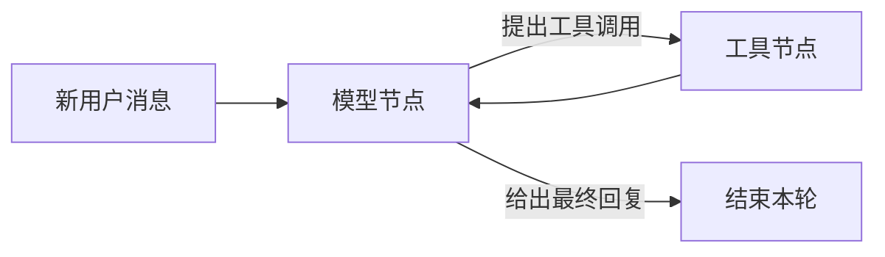

# 第七课：用 LangGraph 编排会话与工具步骤

状态：完整教学资料。前置：[第六课](./06.会话与上下文.md)。[返回课程入口](../学习教程.md)。

## 目标与图的含义

把手写 while 循环拆成有明确状态的节点，为下一课的暂停／恢复提供检查点。第五课已安装 `@langchain/langgraph@1.7.4`。



节点是程序函数，边决定下一步，state 是节点之间传递的数据，checkpointer 保存执行位置及状态。图本身不是模型，也不意味着每条分支都要请求模型。

## 1. 构建可复用的 Agent 图

文件：`common/graph.mjs`，相对于 `scripts/agent-learning/`。

<!-- file: common/graph.mjs -->

```javascript
import { StateGraph, MessagesAnnotation, START, END, Send } from '@langchain/langgraph'
import { ToolNode } from '@langchain/langgraph/prebuilt'
import { SystemMessage } from '@langchain/core/messages'
import { invokeModels } from './invoke.mjs'

/** 构建模型／工具图；根图传 checkpointer，子图省略以继承父图的单次调用检查点。 */
export function buildAgentGraph({ models, tools = [], systemPrompt, checkpointer, hooks = {} }) {
  const names = new Set(tools.map((item) => item.name))
  if (names.size !== tools.length) throw new Error('工具名称重复')
  const clients = models.map((model) => (tools.length ? model.bindTools(tools) : model))
  const executor = new ToolNode(tools, { handleToolErrors: false })

  /** 模型节点只返回本次新增消息，MessagesAnnotation 的 reducer 合并历史。 */
  async function callModel(state, config) {
    const release = await hooks.beforeModel?.(config)
    try {
      const reply = await invokeModels({
        models: clients,
        messages: [new SystemMessage(systemPrompt), ...state.messages],
        signal: config.signal,
        onAttempt: (index) => hooks.onAttempt?.({ index, config }),
      })
      await hooks.afterModel?.({ reply, config })
      return { messages: [reply] }
    } finally {
      release?.()
    }
  }

  /** 工具执行前校验宿主策略；不要捕获并吞掉 LangGraph 的 interrupt。 */
  async function callTools(state, config) {
    config.signal?.throwIfAborted()
    const calls = [state.lg_tool_call]
    if (calls.some((call) => !names.has(call.name))) throw new Error('未注册的工具')
    await hooks.beforeTools?.({ calls, config })
    return executor.invoke(state, config)
  }

  const builder = new StateGraph(MessagesAnnotation)
    .addNode('model', callModel)
    .addNode('tools', callTools)
    .addEdge(START, 'model')
    .addConditionalEdges(
      'model',
      (state) => {
        const calls = state.messages.at(-1)?.tool_calls ?? []
        return calls.length
          ? calls.map((call) => new Send('tools', { messages: state.messages, lg_tool_call: call }))
          : END
      },
      ['tools', END],
    )
    .addEdge('tools', 'model')

  return checkpointer === undefined ? builder.compile() : builder.compile({ checkpointer })
}
```

`MessagesAnnotation` 已定义消息的累加规则，所以每个节点只返回新增消息。把整个旧历史再返回一次可能导致重复，普通状态字段也不能默认假定会累加。

每个工具调用通过 `Send` 分发成独立图任务，`lg_tool_call` 是 ToolNode 支持的单调用输入。工具任务可以并行，它们全部完成后才进入下一轮 model；这也让框架能够同时收集多个工具／子代理的问题，而不是在一个 Promise.all 节点里只收到先抛出的中断。第九课再把动态分发用于更完整的任务计划。

工具错误向上报告，下一课的 `interrupt` 会由图运行时处理。`hooks` 是第十课插入计数、事件与权限检查的位置，当前可以不配置。

## 2. 保存历史，流式观察节点

文件：`07-graph.mjs`。

<!-- file: 07-graph.mjs -->

```javascript
import { MemorySaver } from '@langchain/langgraph'
import { createModel } from './common/model.mjs'
import { buildAgentGraph } from './common/graph.mjs'
import { mathTools } from './common/math-tools.mjs'
import { messageText } from './common/text.mjs'

const graph = buildAgentGraph({
  models: [createModel()],
  tools: mathTools,
  systemPrompt: '你是报告助手。算术用工具，不编造数据。',
  checkpointer: new MemorySaver(),
})
const config = {
  configurable: { thread_id: 'graph-demo-chat' },
  recursionLimit: 24,
  signal: AbortSignal.timeout(60_000),
}
const first = await graph.invoke(
  {
    messages: [{ role: 'user', content: '我的本月目标是 100 项。现在完成 20 + 30 项。' }],
  },
  config,
)
console.log('第一轮：', messageText(first.messages.at(-1)))

const stream = await graph.stream(
  { messages: [{ role: 'user', content: '根据刚才的信息，还差多少项？' }] },
  { ...config, streamMode: 'updates' },
)
for await (const update of stream) {
  for (const [node, value] of Object.entries(update)) {
    console.log('完成节点：', node)
    const last = value?.messages?.at(-1)
    if (last) console.log(messageText(last))
  }
}
const snapshot = await graph.getState(config)
console.log('待运行节点：', snapshot.next)
```

```powershell
vp node --env-file=.env.agent.local scripts/agent-learning/07-graph.mjs
```

`updates` 输出节点完成后的状态增量，不等于 token 流。要看文本逐块输出，可使用 `streamMode: 'messages'`，每项为 `[messageChunk, metadata]`。业务事件、图节点事件和模型 token 是不同层次的信息。

上例 invoke 第一轮、stream 第二轮，分别是两次任务。观察某次任务的进度时，只选择一种启动入口，不能为了看事件再调用一次 invoke 重做同一任务。

## 3. 编排不只有模型循环

确定的查询 → 整理 → 输出也可以各自建节点，中间的纯数据整理直接使用普通函数。只有需要语言理解／生成的节点才调用模型。条件分支由程序返回路由值，依赖数据由 state 传递。

`MemorySaver` 是进程内检查点，能在当前进程保存历史和等待状态；程序重启后不能恢复。需要跨进程恢复时更换持久 checkpointer，并处理凭证、状态版本、鉴权和工具重放；安装 LangGraph 不会自动完成这些工作。

## 观察、练习与完成标准

- 从日志辨认 model → tools → model。
- 同一 `thread_id` 引用上一轮目标，换编号后历史为空。
- 将 `recursionLimit` 设得很小，观察超限；它限制图步骤，不代替总费用预算。
- `getState()` 在本轮结束后应没有待执行节点。下一课会观察暂停后的 `next/tasks`。
- 不用把可信身份放进 state：模型和工具能够看到的状态与宿主鉴权信息需分别管理。

完成标准：能说明 reducer、节点、条件边、检查点各自解决什么问题，以及为什么下一课可以在同一 thread 上恢复。

参考：[LangGraph Graph API](https://docs.langchain.com/oss/javascript/langgraph/graph-api)、[Persistence](https://docs.langchain.com/oss/javascript/langgraph/persistence)、[Streaming](https://docs.langchain.com/oss/javascript/langgraph/streaming)。

下一课：[选项式打断交互](./08.打断交互.md)。
