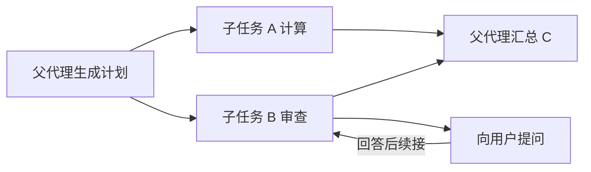

# 第九课：动态子代理、通信与等待汇合

状态：完整教学资料。前置：[第八课](./08.打断交互.md)。[返回课程入口](../学习教程.md)。

## 先讲清你问的两个问题

注册子代理是在提供“可用能力目录”，执行时才决定使用哪些能力、启动多少个任务。同一个能力可以创建多个独立子运行，不需要初始化时固定实例数量。

子代理最常用的通信方式是输入和结果：父代理给明确任务，子代理返回结果；任务 B 依赖 A 时等待 A 完成再启动 B，A／B 独立时并行，C 等两者完成后汇总。等待是程序等待 Promise／图任务状态，不是反复请求模型问“完成了吗”。

## 1. 用动态计划生成子任务

本例提供计算和数据审查两种能力，模型在运行时生成 1 到 3 个任务。使用 `Send` 把计划分发给 worker 节点，并通过 reducer 收集结果。

文件：`09-subagents.mjs`，相对于 `scripts/agent-learning/`。

<!-- file: 09-subagents.mjs -->

```javascript
import {
  Annotation,
  StateGraph,
  START,
  END,
  Send,
  MemorySaver,
  Command,
} from '@langchain/langgraph'
import { z } from 'zod'
import { createModel } from './common/model.mjs'
import { buildAgentGraph } from './common/graph.mjs'
import { mathTools } from './common/math-tools.mjs'
import { createAskUserTool } from './common/interaction.mjs'
import { answerInTerminal } from './common/terminal.mjs'
import { messageText } from './common/text.mjs'

const model = createModel()
const workers = {
  calculate: buildAgentGraph({
    models: [model],
    tools: mathTools,
    systemPrompt: '你负责算术，必须用工具计算，简洁返回结果。',
  }),
  review: buildAgentGraph({
    models: [model],
    tools: [createAskUserTool('review')],
    systemPrompt: '你负责检查报告所需信息。报告类型未知时调用 ask_user，数据不足写待补充。',
  }),
}
const Plan = z.object({
  tasks: z
    .array(
      z.object({
        agentId: z.enum(['calculate', 'review']),
        input: z.string().min(1),
      }),
    )
    .min(1)
    .max(3),
})
const planner = model.withStructuredOutput(Plan)
const State = Annotation.Root({
  input: Annotation(),
  tasks: Annotation(),
  results: Annotation({ reducer: (left, right) => left.concat(right), default: () => [] }),
  output: Annotation(),
})

/** 计划只允许从代码注册的能力中选择，数量由运行时输入决定但受 schema 限制。 */
async function plan(state) {
  const value = Plan.parse(
    await planner.invoke([
      {
        role: 'system',
        content:
          '将任务拆为独立子任务；需要计算用 calculate，需要检查资料用 review。只传必要事实。',
      },
      { role: 'user', content: state.input },
    ]),
  )
  return {
    tasks: value.tasks.map((item, index) => ({ ...item, taskId: 'task-' + index })),
  }
}

/** Send 的数量来自实际计划，不在初始化时固定子代理个数。 */
function dispatch(state) {
  return state.tasks.map((task) => new Send('worker', task))
}

/** 子图默认继承父图的检查点机制；每次调用接收自己的消息，不传整个父历史。 */
async function work(task, config) {
  console.log('启动', task.taskId, task.agentId)
  const result = await workers[task.agentId].invoke(
    {
      messages: [{ role: 'user', content: task.input }],
    },
    config,
  )
  console.log('完成', task.taskId)
  return {
    results: [
      {
        taskId: task.taskId,
        agentId: task.agentId,
        text: messageText(result.messages.at(-1)),
      },
    ],
  }
}

/** 所有本批 worker 的结果就绪后才执行汇总，不依赖返回先后顺序。 */
async function summarize(state) {
  const results = [...state.results].sort((a, b) => a.taskId.localeCompare(b.taskId))
  const reply = await model.invoke([
    { role: 'system', content: '根据子任务结果写中文报告，不编造缺失数据。' },
    { role: 'user', content: JSON.stringify({ task: state.input, results }) },
  ])
  return { output: messageText(reply) }
}

const graph = new StateGraph(State)
  .addNode('plan', plan)
  .addNode('worker', work)
  .addNode('summarize', summarize)
  .addEdge(START, 'plan')
  .addConditionalEdges('plan', dispatch, ['worker'])
  .addEdge('worker', 'summarize')
  .addEdge('summarize', END)
  .compile({ checkpointer: new MemorySaver() })

const config = {
  configurable: { thread_id: 'subagents-demo' },
  recursionLimit: 50,
  maxConcurrency: 3,
}
let result = await graph.invoke(
  {
    input:
      '本月完成了 12 项和 8 项工作。请计算合计，同时检查是否足够写报告；报告类型未提供，请澄清。',
  },
  config,
)
while (result.__interrupt__?.length) {
  const resume = {}
  for (const item of result.__interrupt__) {
    resume[item.id] = await answerInTerminal(item.value)
  }
  result = await graph.invoke(new Command({ resume }), config)
}
console.log('所有子任务结果：', result.results)
console.log('汇总：', result.output)
```

```powershell
vp node --env-file=.env.agent.local scripts/agent-learning/09-subagents.mjs
```

## 2. 为什么子代理提问能回到用户

父图有 checkpointer，子图编译时省略该参数，按单次调用继承父图检查点。子图的 `interrupt` 会出现在父运行的 `__interrupt__` 中，宿主按每个 ID 提交答案，框架恢复对应子执行。

不要给每个子调用随手换新的根 threadId 来“恢复”，那会变成新任务。也不把子代理的等待状态包装成正常文本，让父模型误以为任务已经完成。

并行 worker 中一个需要回答时，其他独立任务可以执行并保存结果；依赖整个批次的 summarize 继续等待。恢复会重进相关节点，写操作仍须遵循第八课的幂等规则。

## 3. 明确依赖与结果通信



如果 B 真正依赖 A 的结果，应设计成 A → B 的边或先 `await A` 再启动 B，不能先并行启动 B，再假设它能看到 A 未来的状态。子代理的输入和输出是通信，直接聊天消息则是另外一种机制，本课不增加任意代理互发消息。

任务标识用于查结果与关联运行。这个课程脚本由图管理等待，不额外实现一个 taskId 轮询服务。真实外部任务需要持久任务表及状态协议时，再单独设计。

## 4. 失败、预算和动态创建的边界

- 本例 worker 失败则本批任务失败，未失败子任务的检查点可供诊断；不把失败结果默认为空字符串。
- 整个任务的深度、总模型次数、总 token、并发和截止时间应由父级预算约束，不能每个子代理重新发一份无限预算。
- `maxConcurrency` 约束图调度，不保证约束你随手写的所有 `Promise.all`；第十课额外给模型请求设置共享并发闸门。
- 动态是“按任务选模板、传任务、确定数量”，不是允许模型随意申请管理员工具、执行磁盘脚本或无限递归。
- 本课计划与汇总节点还直接调用模型，第十课统一到运行时的计数、信号和事件里。

## 练习与完成标准

1. 把输入改成只需要算术，观察计划数量变化。
2. 让两个 review 任务同时缺少条件，观察多个交互 ID，分别回答。
3. 让一个任务故意失败，确认父任务不会展示为成功。
4. 将 B 改成需要 A 的输出，画出依赖边，并先按顺序调用实现。
5. 子代理的 system prompt 可以不同，模型也可以不同；不自动复制父历史和凭证。

完成标准：能解释能力注册与实际启动数量的区别，并亲眼看到 A／B 并行、C 等待，以及子代理问题的正确路由。

参考：[LangGraph Workflows and agents](https://docs.langchain.com/oss/javascript/langgraph/workflows-agents)、[Subgraphs](https://docs.langchain.com/oss/javascript/langgraph/use-subgraphs)。

下一课：[组件式封装](./10.通用封装.md)。
