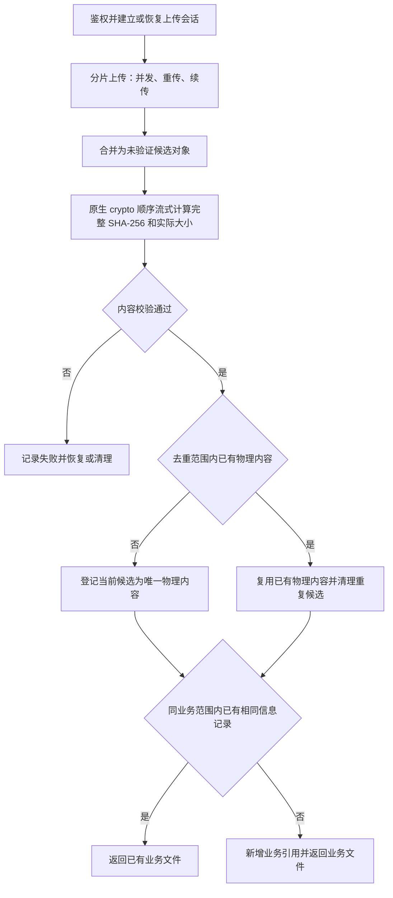
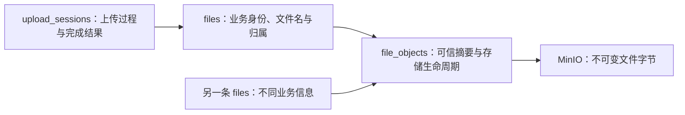

# 上传改造方案

> 状态：2026-10-15 服务端 crypto 与前端 Worker + hash-wasm 摘要模块已实现并完成本地验证；业务去重模型仍待确认，真实存储与 90 GiB 性能未验证。
> 适用范围：浏览器、NestJS、PostgreSQL、MinIO；前端本轮交付独立可调用模块。
> 需求来源：[需求文档](./需求文档.md)。当前上传说明：[分片上传实施教程](../分片上传/实施教程.md)。

本文将“内容唯一存储、业务信息独立引用”作为总体方案主线。原稿中单层 `files`、业务 `fileId` 作为对象 Key、对象固定业务文件名、删除业务文件直接删对象的设计已被本方案替代。原公开下载草案仅保留为第 12 节的独立候选。当前落实第 5 节服务端可信摘要和第 7 节前端本地摘要模块，实施边界以[技术契约](./技术契约.md)为准。

## 1. 方案总览

建议先实现上传后可信校验与去重；若需要上传前秒传，再增加前端完整摘要与可信复用流程。

| 讨论事项       | 整理后的建议                                           | 状态                                 |
| -------------- | ------------------------------------------------------ | ------------------------------------ |
| 内容与业务信息 | 物理文件、业务文件、上传会话分别管理                   | 来自用户目标，具体字段待冻结         |
| 内容标识       | 完整 SHA-256 + 实际字节数 + 去重范围                   | 建议采用；不能用 Multipart ETag 代替 |
| 服务端计算     | Node.js 原生 crypto，Worker 线程执行增量摘要           | 已确认 crypto；本次实施摘要基础能力  |
| 调度           | 本次请求内等待；持久化队列后续按实测选择               | 队列不是计算正确性的前提             |
| 前端计算       | Web Worker + hash-wasm 增量计算，独立可调用模块        | 已实现并验证，上传入口与秒传后续接入 |
| 并发与删除     | 数据库约束收敛重复，业务删除解除引用，物理内容独立回收 | 后续必须实现的正确性要求             |
| 下载           | 按业务记录生成下载名，权限／公开策略独立决定           | 下载策略待确认                       |

三种最终结果：

| 内容     | 当前业务范围内的业务信息 | 最终结果                       |
| -------- | ------------------------ | ------------------------------ |
| 首次出现 | 任意                     | 新物理内容 + 新业务文件        |
| 已存在   | 相同                     | 返回已有业务文件               |
| 已存在   | 不同                     | 新增业务文件，引用已有物理内容 |



图中从内容去重到业务引用的步骤是待确认的后续目标。当前实施服务端完整摘要、大小校验和完成持久化，前端另交付本地摘要模块。

## 2. 当前实现与改造边界

2026-10-14 已核对的当前事实：

| 项目     | 当前实现                                                                     | 改造要求                             |
| -------- | ---------------------------------------------------------------------------- | ------------------------------------ |
| 会话幂等 | 按 `ownerId + clientUploadId` 恢复会话                                       | 保留；不能用会话幂等替代内容去重     |
| 存储对象 | 新会话生成新的随机对象 Key                                                   | 新增验证及物理内容复用               |
| 数据模型 | 上传相关只有 `upload_sessions`，没有长期 `files` 或 `file_objects`           | 拆分业务、内容与过程                 |
| 摘要     | 没有完整文件内容 SHA-256 流程                                                | 增加服务端可信计算                   |
| 完成响应 | `uploadSessionId/status/objectKey/etag`                                      | 返回业务文件结果，不公开内部存储字段 |
| 归属     | 上传记录主要使用 `ownerId`；组织模型已存在，但上传尚未接入公司／项目归属校验 | 复用现有权限事实来源                 |
| 分片限制 | 当前分片 10 MiB，最大文件 90 GiB                                             | 保持流式处理，避免完整文件入内存     |
| 对象访问 | 当前 `uploads` Bucket 私有；公开 Nginx 文件代理尚未实现                      | 不把去重改造等同于匿名公开           |

当前源码入口：[上传服务](../../../apps/server/src/modules/upload/upload.service.ts)、[数据库模型](../../../apps/server/src/database/schema.ts)。公共队列已有基础能力，上传摘要本次采用请求内等待；共享内容回收尚未实现，见[公共队列设计](../../03.任务队列/公共队列/设计方案.md)。

上表是改造前基线。本次增加完整 SHA-256 与完成恢复，不实施三表业务去重、历史内容搬移或部署。

## 3. 数据职责与标识

### 3.1 三层模型



| 模型              | 职责                       | 候选字段                                                                                                 |
| ----------------- | -------------------------- | -------------------------------------------------------------------------------------------------------- |
| `file_objects`    | 唯一物理内容及存储生命周期 | `id/dedupScope/sha256/byteSize/bucket/objectKey/status`，对象版本或其他不可变身份、验证／回收时间        |
| `files`           | 长期业务文件身份           | `id/fileObjectId/fileName/companyId/projectId`、用途／描述等业务信息、`uploadedBy/status`、审计时间      |
| `upload_sessions` | 分片、续传、完成幂等与恢复 | 会话 ID、`ownerId/clientUploadId`、候选对象身份、业务信息快照、分片参数、有效期、验证尝试、完成 `fileId` |

物理内容中不保存某条业务记录的名字和公司／项目作为共享内容身份。文件后缀可以由业务文件名规范化得到；实际大小和经验证的内容属性来自物理层。

`fileId`、`fileObjectId`、`uploadSessionId` 含义不同。上传开始时可生成候选物理对象 ID，但最终业务文件 ID 在判等完成后确定；重复上传可能返回此前已存在的 `fileId`，不能承诺每次初始化得到的业务 ID 都是最终结果。

### 3.2 内容唯一约束

建议内容唯一键为：

```text
(dedupScope, sha256, byteSize)
```

SHA-256 必须来自服务端对固定版本的完整对象计算。大小是额外完整性检查，不能单独用于去重。去重范围可能是企业或独立存储域，尚未确定是否全局。

可复用内容必须处于 `available`。唯一约束同时保护待回收但尚未删除的内容；遇到 `reclaiming` 时不能直接新增引用或建立第二条活跃物理记录，需要等待回收结束后重试。已删除记录的保留与唯一索引策略在实施时冻结。

### 3.3 业务判等约束

判等依据为“有权访问的业务范围 + `fileObjectId` + 规范化业务信息”。候选字段包括公司、项目、文件名、用途、描述等；上传人是否参与需要确认。

规范化需明确大小写、首尾空白、空值、无项目情况及软删除记录。数据库必须约束有效业务记录的重复，不能只依赖“先查询，查不到再插入”。

业务信息相同则返回已有记录；业务信息不同则建立新引用。若允许改名，改名后与已有记录相同的冲突处理需另行确定。

### 3.4 对象 Key

建议使用独立随机物理标识，例如：

```text
objects/<yyyy>/<MM>/<candidateObjectId>
```

对象 Key 不含业务名字、用户、公司或项目 ID。候选对象验证通过且赢得去重后，可以直接保留同一私有 Bucket 和 Key，只更新数据库引用及状态，无需为了“转为最终文件”再复制 90 GiB 内容。

候选与最终对象的区别由可恢复状态管理；采用上述方式时，不能对这类 Key 使用不检查引用的统一过期删除规则。若以后要求从私有暂存 Bucket 发布到公开 Bucket，则另行设计复制与发布，不把移动视作免费的重命名。

## 4. 分片文件如何计算 SHA-256

### 4.1 完整摘要定义

将文件按原始字节顺序分成任意读取块，始终更新同一个摘要实例：

```text
hasher = SHA256()
hasher.update(原始字节块 1)
hasher.update(原始字节块 2)
...
digest = hasher.finalize()
```

读取块大小不影响结果，也不必与上传分片大小相同。文件名和业务信息不参与内容摘要。

下列结果不是普通完整文件 SHA-256：

```text
SHA256(分片 1 的摘要 + 分片 2 的摘要 + ...)
```

独立分片摘要可用于分片校验，但不能拼接或再次散列后冒充完整文件摘要。常规完整 SHA-256 依赖顺序状态，不能通过独立并发计算每片后直接合成。

### 4.2 推荐服务端路径

1. 校验分片编号、大小、缺片及当前会话权限。
2. 等待分片写入结束，冻结完成流程，执行 MinIO 合并。
3. 服务端从合并后的完整候选对象按原字节顺序流式读取，原生 crypto 连续计算。
4. 对同一实例增量计算，同时累计实际字节数。
5. NestJS 验证结果身份、摘要格式和大小，进入去重事务。

因此乱序、并发、重传和续传不要求在每次上传分片时维护全局摘要状态。若改为接收分片时就计算完整摘要，必须解决排序、重传、并发状态与故障恢复，复杂度明显增加，不作为首版建议。

MinIO Multipart ETag 不是完整文件 MD5，也不能作为完整 SHA-256。建议使用 SHA-256；MD5 已有已知碰撞问题，不作为本方案的内容唯一标识。

### 4.3 成本与可信边界

SHA-256 计算本身消耗 CPU；本方案同时包含 MinIO 读取，整体耗时可能受 CPU、网络、存储或并发限制。流式处理使内存保持有界，不减少需要处理的总字节数。

合并后计算会新增一次完整对象读取。90 GiB 文件实际耗时需要测量，不能只比较哈希算法循环速度。

计算期间对象必须不可变：控制写入权限，禁止同 Key 覆盖；启用版本管理时固定对应版本。任务记录候选对象和尝试身份，结果写回必须匹配当前状态，避免旧结果验证了另一份内容。

## 5. 原生 crypto 与执行线程

### 5.1 职责划分

NestJS 负责鉴权、会话状态、MinIO 流读取及持久化；Node Worker 线程持有一个 `createHash('sha256')` 实例，按收到的原始字节顺序执行 `update()`，最终 `digest('hex')`。不新增 Rust、WASM 或第三方摘要依赖。

### 5.2 本次执行与资源协议

主线程读取带 `If-Match` 条件的完整对象，核对会话元数据、ETag 和长度。每次只发送一块独占缓冲区，等待线程确认后继续，防止消息积压或误转移 Buffer 池。每块最多 256 KiB，不聚合整文件。

每进程最多同时校验 2 个不同会话，超出返回可重试错误；同一进程中同会话共享进行中的校验。单次校验上限 30 分钟，读取、线程异常、超时或应用关闭时销毁流并终止线程。多实例限制按进程累加，需要按实际部署容量评估。

摘要与 `completed` 使用一次条件更新写入，只允许 `completing` 完成；失败保留候选，后续请求重读完整对象。worker 资产随 Nest 构建复制，必须验证生产路径可运行。内部协议只在后端使用，不新增公开响应字段。

### 5.3 性能边界

原生 `crypto` 使用底层加密库；`update()` 同步执行 CPU 工作，流式与 `async` 都不会自动隔离这部分计算。Worker 用于线程隔离，不承诺吞吐提高；消息确认、缓冲区复制和额外对象读取都有成本。仍需测量 CPU、内存、存储带宽及 API 延迟。

## 6. 异步调用与队列的选择

SHA-256 算法执行仍按顺序处理字节。“异步”指 NestJS 不在事件循环中执行或阻塞等待该计算，并不表示算法本身免除 CPU 工作。

### 6.1 方案 A：请求内异步等待

```text
complete 请求 → 合并 → await 原生 crypto 校验 → 持久化完成结果
```

这是本次实施路径。HTTP 请求等待线程计算，主线程继续处理其他事件；实际超时仍受客户端、网关和服务配置影响。

限制是请求与连接持续存在，客户端或网关可能超时。进程退出和服务重启仍需要依靠持久化会话状态恢复，不能因采用直接调用就省略恢复和幂等。

### 6.2 方案 B：持久化队列与 Worker

```text
complete 请求 → 合并并记录待验证 → 返回校验中
后台 Worker → 原生 crypto 校验 → 去重事务 → 固化完成结果
前端查询会话 → 得到校验中、失败或业务文件
```

适用于大文件、长耗时、较高并发、需要重试和跨重启恢复的情况。当前允许 90 GiB，后台方案具有实际价值，但不把队列写成计算必需条件。

若采用队列，数据库待验证状态与投递需可恢复，例如事务发件箱或补投对账；不能依赖“数据库写成功后调用一次入队”就保证任务不丢失。任务允许重复投递，写回必须幂等。

若后续采用此路径，CPU 密集工作使用独立物理队列／Worker 并限制计算并发，遵循[公共队列设计](../../03.任务队列/公共队列/设计方案.md)。队列管理调度、重试和恢复；计算隔离由进程／线程承担。

### 6.3 选择建议

先用代表性文件测量完整读取与哈希耗时，再依据允许的请求时长、上传量和资源容量选择。可以按耗时／大小选择同步返回或“校验中”，但前端必须接受一致的结果语义。

可靠后台任务也可基于数据库任务表和独立调度器实现；如果不用队列，仍需实现领取、重试、租约、恢复和并发控制，不能仅启动任务后立即返回。

## 7. 前端 Worker 与 WASM

### 7.1 是否需要前端摘要

仅实现最终存储去重时，前端完整摘要不是必要条件。

需要上传前复用查询／秒传时，前端先顺序读取完整文件并计算候选摘要，会增加本地读取和上传开始前的等待。也可以边上传边计算，但此时无法在传输开始前完成整文件查询，主要用于进度和校验辅助。

服务端不能把客户端摘要当作已验证内容；即使前端算过，首次内容仍需服务端校验。对于已有内容的跳过上传，只允许在已授权且满足可信复用／持有验证条件时执行，策略待确认。

### 7.2 Worker 的职责

本轮把 File／Blob 通过结构化克隆交给 Worker，由 Worker 自行按顺序读取默认 4 MiB 的小块：

```text
主线程传 File
  → Worker 分块读取
  → 同一个增量 SHA-256 实例 update
  → 返回进度／结果／失败，响应取消
```

这样避免主线程逐块读取和搬运文件。Worker 可以按进度间隔发送消息，避免过度通信；取消可以协作停止或终止专用 Worker。不会一次把完整大文件放入内存。

### 7.3 WASM 的职责与开销

Worker 决定执行位置；WASM 决定算法实现，两者可组合，也可以在 Worker 中使用其他增量库。

浏览器 `crypto.subtle.digest` 没有标准增量输入接口；不能为 90 GiB 文件先建立完整 ArrayBuffer。本轮选用现成增量库 hash-wasm，不自行维护 Rust→WASM 内核。

Rust 源码到 WASM 通常在构建时完成，浏览器接收的是编译后的模块；运行时仍有下载、编译／实例化、跨边界调用及内存复制成本。读取的 ArrayBuffer 写入 WASM 线性内存仍可能发生复制，不能承诺使用 Worker 后“完全零拷贝”。

按适当大小逐块调用可减少跨边界次数；最终以启动时间、吞吐、峰值内存和页面响应实测决定，不预先宣称 WASM 更快。

### 7.4 本轮实施边界

前端入口放在 `apps/web/src/services/file-hash/`，Worker 与并发名额管理置于同功能目录；增量读取算法置于 `packages/shared/src/utils/file-hash/`，共享选项与消息类型置于 shared/types。选用 `hash-wasm` 的 `createSHA256()`，不自行编译 Rust。每文件独立 Worker，每个模块实例最多两个任务，等待采用 FIFO，取消等待不创建线程，取消执行立即 terminate；任何结局都释放监听和名额。主线程不读取文件字节。

当前没有前端上传页面，本轮只交付可调用模块和使用说明，不添加秒传接口或业务 UI。客户端摘要仍需服务端可信校验。WASM 初始化、复制和真实大文件性能以实际验证为准；本轮不声称已验证 90 GiB。

## 8. 完成、并发与恢复

### 8.1 后续完整去重的会话状态建议

本次已实施的状态为 `uploading → completing → completed`；合并和验证均在 `completing` 中执行，失败保留该状态，合并前可修正错误允许回退。完整规则见[技术契约](./技术契约.md)。下列 `verifying` 等状态仅是后续业务去重的候选，并非当前接口状态。

```text
uploading → completing → verifying → completed
    │             │            │
    └─取消／过期   └─合并恢复    └─失败／重试／取消处理
```

后续独立验证／调度状态名和转换契约待冻结，不能把合并成功当作业务文件已经可用。

### 8.2 完成与去重流程

1. 条件更新抢占当前会话的完成流程；阻止继续改写候选对象。
2. 校验分片并合并。合并发生超时／未知结果时保留恢复状态，通过对象存在性、大小和固定身份判断，不直接回到可重写的上传状态。
3. 持久化待验证和尝试身份，直接调度或可靠投递摘要任务。
4. 校验原生 crypto 结果；如后续增加客户端摘要，同时检查其与服务端结果一致。摘要或大小不符时不发布。
5. 在数据库事务中尝试按内容唯一键登记物理内容；冲突则取得并锁定已有物理记录，确认处于可引用状态。
6. 根据业务判等约束取得已有业务文件或新增引用。
7. 在同一事务内把业务文件 ID 和结果关联回当前会话，标为完成。旧尝试不得覆盖已取消或已完成结果。
8. 在事务内记录未获选候选的待清理意图。清理任务抢占候选的清理状态，排除仍可能发布的尝试，并核对真实物理引用；清理与发布互斥，不能仅先查无引用再删除。

同内容并发上传可能暂存多个对象，但数据库唯一约束决定唯一获选者。另一请求只创建引用或返回已有业务记录；失败的候选不能成为第二份最终内容。

同 `clientUploadId` 重试需要比较不可变初始化信息；信息变化不能悄悄改写会话。完成重试直接返回已固化结果，不能重新选择不同业务文件 ID。

### 8.3 故障恢复

| 故障                       | 恢复要求                                                         |
| -------------------------- | ---------------------------------------------------------------- |
| 合并成功但响应未知         | 查询固定候选对象并继续验证，避免再次开启可覆盖上传               |
| 线程退出、超时或结果无效   | 保留未完成状态；可重试时重新读取完整对象                         |
| 数据库事务失败             | 保留候选与可信结果身份，按当前状态重试，不立即删除可能获选的对象 |
| 队列漏投／重复任务         | 持久化状态补投；重复处理经条件更新及唯一约束幂等收敛             |
| 去重成功但重复对象清理失败 | 记录待清理并重试，不影响已经固化的业务结果                       |
| 取消与验证同时完成         | 用会话状态和尝试身份决定谁能写回，已取消内容不能发布             |

不承诺序列化 SHA-256 中间状态后即可跨版本、跨进程任意续算；首版重试按完整对象重新计算。

## 9. 接口结果与权限

以下是语义建议，不是已实现或已冻结的 DTO：

| 场景                       | 建议结果                                 |
| -------------------------- | ---------------------------------------- |
| 正常初始化                 | 会话、分片规则、续传进度                 |
| 可选预查询达到可信复用条件 | 已有业务文件，或新建业务引用后的文件     |
| 请求内完成                 | 经验证的业务文件结果                     |
| 后台完成尚未验证           | 会话 ID 与校验中状态，前端查询           |
| 查询已完成会话／完成重试   | 同一业务文件结果                         |
| 验证失败                   | 明确失败状态和可公开错误，不返回可用 URL |

业务文件候选字段：`fileId/fileUrl/fileName/fileSuffix/fileSize/companyId/projectId`。后缀小写、不带点，无后缀可为 null；大小来自服务端验证。完成结果不增加重复 `uploadSize` 或含义不明的 `group`。进度接口可独立提供 `uploadedSize`。

响应遵循[API 与统一错误技术契约](../../07.API与错误/技术契约.md)：成功直接返回业务正文，错误为 `{ code, message, details? }`。不向前端直接返回 `bucket/objectKey/storageUploadId`、内部 MinIO 地址或凭据。未来 URL 由业务文件 ID 和部署配置生成，不作为数据库事实固化域名。

初始化、查询、分片、完成、取消和删除请求均校验权限；私有文件下载同样校验，公开下载仅在独立公开策略确定后适用。公司／项目从现有数据库反查归属，不能直接信任客户端字段或 `X-Company-Id`。物理内容复用不授权其他企业的业务记录。

## 10. 下载名、引用删除与清理

### 10.1 下载名字

同一物理内容可以对应“合同.pdf”和“附件.pdf”。下载时按所访问 `fileId` 查询对应名字并生成 `Content-Disposition`，不把任意一个业务名字固定到共享 MinIO 对象元数据。

可选实现是鉴权后生成带响应头覆盖的预签名 URL，或经按业务 ID 的下载入口／网关设置响应头。名称清理控制字符，采用安全 ASCII fallback 和 RFC 5987 `filename*`；缓存区分业务文件或响应头覆盖参数，避免名字串用。

直接 Nginx 读取同一个物理对象通常返回相同固定元数据，不能自动满足多个业务名字；若采用该链路，需要补充按业务文件处理下载名的入口。

### 10.2 删除与物理回收

1. 按业务文件 ID 鉴权，事务内删除或软删除相应业务引用。
2. 存在仍需保留的有效／保留期引用时，继续保留物理对象。
3. 达到约定保留期且无引用时，锁定物理记录，重新核对真实引用，将其标为 `reclaiming`。
4. 新增引用同样锁定物理记录，并只允许引用 `available`；回收中的记录不能接受新引用。
5. 删除存储对象后标为 `deleted`；存储失败则保持受保护回收状态并重试。

引用计数可优化查询，但真实引用和回收协议是正确性依据；不能只读到计数为零就删除。

### 10.3 三类清理分开处理

| 清理对象           | 依据                             | 禁止事项                           |
| ------------------ | -------------------------------- | ---------------------------------- |
| 未完成 Multipart   | 会话取消／过期、当前写入状态     | 不能顺便删除已完成共享对象         |
| 失败／重复候选对象 | 候选身份、失败状态及是否获选     | 不能删除已经成为有效物理内容的候选 |
| 无引用最终对象     | 保留期、真实引用、受保护回收状态 | 不能与新引用竞争形成失效业务记录   |

现有[过期上传清理方案](../上传清理/设计方案.md)以当前会话模型为基线；实施新模型时要更新其清理判断，不能照搬为共享文件回收。

## 11. 实施、迁移与验证计划

### 11.1 建议顺序

1. 确定业务判等字段、去重范围、下载权限和完成响应；补充可联调技术契约。
2. 新增物理／业务模型及加法式迁移，保留会话幂等和分片兼容。
3. 服务端完整摘要与完成恢复先按本次技术契约实现；并发去重与重复候选清理待判等规则确认后实施。
4. 根据大文件耗时及恢复要求接入直接等待或持久化后台调度。
5. 只有需要上传前查询／秒传时再实现 Worker 与增量 WASM；同时冻结持有验证策略。
6. 实现按业务文件下载名、引用删除与物理回收；历史数据迁移和公开发布按独立选择推进。

后续完整去重预计涉及上传服务、存储适配器、数据库模型、共享类型、新文件业务模块及测试。新增迁移采用当时的下一编号，不能沿用旧稿预写的 0002，更不能改已应用迁移。

### 11.2 历史内容与回滚

若纳入历史数据：先对既有完成对象计算可信摘要，建立物理记录并回填业务引用；对账记录数、对象数、字节数、权限归属和缺失对象，再合并重复内容。未确认前不搬移或删除历史对象。

迁移以新增表／字段开始，不立即删除旧列。通过开关控制新完成流程及结果兼容；回滚时保留已验证内容和新表用于恢复，不把停用新逻辑等同于删除共享对象。

### 11.3 正确性与性能验证

业务验收以[需求文档第 6 节](./需求文档.md#6-验收标准待实施)为准。实施后需重点验证：

- 空文件、二进制文件、同名不同内容、同内容不同名及同内容同信息。
- 任意分片顺序、重传、续传与不同读取块大小的摘要一致性。
- 物理／业务并发唯一约束、完成重试、错误尝试写回及引用回收竞争。
- MinIO 合并结果未知、数据库失败、进程退出、队列重复／漏投及重复对象清理失败。
- 业务权限、客户端摘要可信边界、验证前不可用和下载名字一致性。

性能验证使用代表性小、中、大文件和实际并发，记录原生 crypto 的完整 MinIO 读取耗时、CPU、内存、存储带宽及 API 延迟。若后续引入前端计算，比较增量实现的加载时间、吞吐、数据复制、峰值内存与页面响应。

一次标准摘要向量正确不能替代大文件及并发验证。本次基础能力、生成流观察及未覆盖边界见[测试报告](./测试报告.md)；上面的完整去重和真实存储性能验收仍待实施。

## 12. 原公开下载方向的独立候选

> 本节来自早期公开下载讨论，是否采用待确认。它不改变本轮去重主线，不表示文件全部公开或部署已完成。

如果确认一部分文件真正公开，可使用独立 `public-files` Bucket，仅允许匿名 `s3:GetObject`，禁止列表、写入、删除和管理 API。私有暂存与公共发布分离；内容验证和必要检查通过后才发布，不能在合并未验证内容时就使其匿名可访问。

90 GiB 对象跨 Bucket 发布需要考虑 S3 Multipart Copy 或可靠异步发布，不能依赖单次 CopyObject。公开／私有复用范围及公开副本是否属于同一物理存储域需另行确定，不能承诺跨可见性域只存一份。

普通 Nginx 反代不会自动签名访问私有 MinIO；公开 GetObject、预签名 URL 和签名网关是不同访问方案。公开代理可保留以下早期语义示例，正式路径需与按业务文件下载入口协调：

```nginx
upstream minio_public {
  server minio:9000;
  keepalive 32;
}

location = /files {
  return 404;
}

location = /files/ {
  return 404;
}

location /files/ {
  # GET 规则同时允许 HEAD；其他方法拒绝。
  limit_except GET {
    deny all;
  }

  proxy_http_version 1.1;
  proxy_pass http://minio_public/public-files/;
  proxy_buffering off;
  add_header X-Content-Type-Options nosniff always;
}
```

实施公开访问时还需验证 Range、条件请求、固定 Bucket 映射、路径编码、根路径不列举和写方法拒绝；MinIO 9000 仅供内网访问，9001 控制台不暴露公网，应用账号与根账号分离。

公共内容建议使用独立无 Cookie 域名；HTML、SVG 等类型按用途限制或强制 attachment，不仅信任客户端 MIME。对象不可变才适合长期缓存，需要撤回时按约定缓存与 purge 策略处理。业务记录删除而共享对象仍有引用时，不能靠删除共享内容撤销单条业务链接。

本节配置未部署；公共 URL 被下载后的第三方副本不属于技术回滚可收回的内容。

## 13. 待确认与实施清单

业务选择统一维护在[需求文档第 7 节](./需求文档.md#7-待确认事项)。当前重点是判等字段、去重范围、是否秒传、是否需要后台调度以及下载策略。后端摘要确定使用原生 crypto。

本次服务端摘要与完成恢复已实现，验证见[测试报告](./测试报告.md)，发布与兼容见[交付记录](./交付记录.md)。后续完整业务去重实施检查：

- [ ] 判等、去重范围、授权和可见性规则明确。
- [ ] 完成／查询／失败语义及共享类型契约冻结。
- [ ] 物理、业务和会话职责分离，数据库约束能防止并发重复。
- [ ] SHA-256 结果可信，固定候选对象身份，内存有界。
- [ ] 直接调用／后台调度具有幂等、取消、恢复和并发限制。
- [ ] 验证前不发布，重复与失败对象可补偿清理。
- [ ] 下载名按业务文件生成，引用回收无竞争漏洞。
- [ ] 可选秒传具备授权及可信复用／持有验证策略。
- [ ] 原生 crypto 及后续可选 WASM 有端到端性能证据。
- [ ] 历史迁移、兼容、回滚及可选公共发布均有对账。

## 14. 变更记录

2026-10-15：用户确认执行前端 Worker + hash-wasm 模块；新增分块、进度、取消与并发上限设计，上传入口和秒传后续接入。

2026-10-15：根据用户确认，以原生 crypto 替代服务端 Rust 候选，实施请求内等待的线程计算、条件读取、摘要持久化、失败恢复和加法式迁移。业务去重范围及判等尚未冻结，因此本次不实施三表去重；验证状态见测试报告。

| 日期       | 摘要                                                                                                                      | 影响范围                                 | 原因                                                                                 |
| ---------- | ------------------------------------------------------------------------------------------------------------------------- | ---------------------------------------- | ------------------------------------------------------------------------------------ |
| 2026-10-14 | 复核会话幂等与内容去重差异；记录物理文件／业务引用候选模型                                                                | 需求、模型、接口、下载、删除与验收       | 用户提出内容唯一存储、业务信息独立引用                                               |
| 2026-10-14 | 补充 Rust 摘要程序和前端 Worker／WASM 候选                                                                                | 后端计算、调度、状态和前端预计算         | 用户希望独立执行大文件计算                                                           |
| 2026-10-14 | 将散落讨论整理为一份现行方案，替换已过期单层设计，保留公开下载为独立候选；明确直接等待与队列两种选择、WASM 成本及可信校验 | 全文结构、执行流程、性能、恢复和引用回收 | 用户要求整理方案；避免旧基线与新设计冲突，避免将 Rust、WASM 或队列写成必然提速或必选 |
