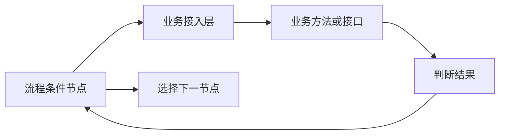

# 流程与业务解耦设计讨论

状态：待确认。本文为架构建议，不代表当前实现或已批准方案。

日期：2026-10-14。需求来源见[需求文档](./需求文档.md)。

## 解耦边界

可以解耦：流程引擎依赖稳定的数据和判断契约，由业务接入机制提供实现，不直接依赖业务表结构、具体服务类、接口地址或领域算法。

引擎可以通用；引用业务字段和能力的具体流程定义仍有业务语义。跨业务复用同一份定义，需要各业务映射到含义一致的输入或能力，不能仅替换业务记录 ID。

## 最小职责划分

| 部分             | 职责                                           | 示例                                                  |
| ---------------- | ---------------------------------------------- | ----------------------------------------------------- |
| 流程引擎         | 节点执行、通用条件比较、分支选择和实例状态     | 将数值与阈值比较，根据判断结果选择下一节点            |
| 业务接入／适配层 | 绑定业务记录、映射字段、解析能力标识、转换结果 | 总额映射为 amount，能力标识映射到本地方法或 HTTP 接口 |
| 业务模块         | 提供业务事实、领域判断与数据访问控制           | 计算订单金额、判断授信资格                            |

这些职责可以在同一应用内划分，解耦不要求拆微服务或全部使用 HTTP。

## 指标比较

业务计算金额，接入层提供标准字段 amount；流程配置 amount > 10000，满足时进入指定节点。引擎只执行比较，无需知道金额来自哪些表及如何计算。

“多少金额需要加签”可作为流程配置；金额计算及汇率等业务口径留在业务层。跨业务映射时，amount 的含义和单位需要一致。动态编辑器需要业务提供可用字段目录，具体结构待确认。

## 调用业务判断

流程引用注册的判断能力，例如 customer.creditEligible。接入层找到相应业务实现，传入有权限的业务标识和必要输入，将返回值转换为流程理解的结果。

编辑器建议从注册目录选择字段或能力。接口地址、凭证和返回值解析归接入层管理，无需给设计者提供任意 URL、数据库查询或脚本执行能力。

授信等领域规则归业务，引擎只按结果分支。结果可使用布尔或有限枚举，正式契约需在场景确认后确定。

## 动态创建与实施前语义

动态创建表示组合系统支持的节点、字段与能力；新的领域判断仍由业务提供并注册。新增能力无需修改通用引擎，但需要接入实现。

- **版本**：运行中实例使用稳定流程版本；字段或能力语义变更另行考虑兼容，固定流程版本不会自动冻结外部业务算法。
- **取值时机**：明确快照与实时取数，并保存必要判断依据及来源。
- **分支匹配**：明确单选／多选、优先级、默认分支和无匹配行为。
- **调用失败**：业务不满足、缺失数据、超时和异常分别处理；超时不能直接当作 false。重试和人工处理策略待确认。
- **副作用**：判断建议只读；扣款、占用库存等动作单独建模。可重试调用需考虑幂等。
- **权限**：能力和字段按业务及作用域授权，接入层检查数据权限，记录标识不能扩大访问范围。

## 变更记录

| 日期       | 摘要                                                         | 影响范围         | 原因                       |
| ---------- | ------------------------------------------------------------ | ---------------- | -------------------------- |
| 2026-10-14 | 提出引擎、业务接入和业务模块划分，说明两类分支与定义复用边界 | 讨论方案，未实施 | 回答业务依赖存在时能否解耦 |
