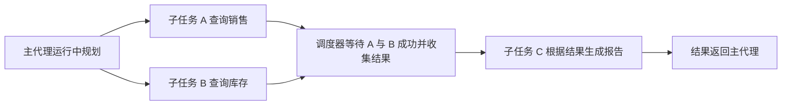
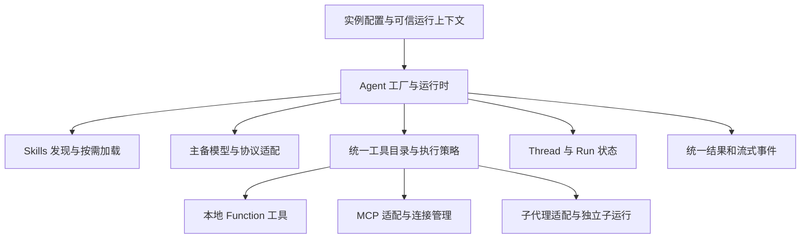

# 通用智能体运行时设计方案

状态：待确认，未实施。用户已明确目标是组件式初始化、既可独立运行也可组合为子代理的通用 Agent 运行时，详见[需求文档](./需求文档.md)。

日期：2026-11-12。本次澄清增加 Agent 组合与子代理要求，直接更新原正文；原先产品内业务查询助手的用途假设已被替代。

## 推荐结论

封装方向合理。建议把 Agent 设计成可组合的运行单元，提供稳定、简洁的自身 API；同一 Agent 可以独立执行，也能通过适配成为父 Agent 可调用的能力。先完成一个执行内核及子代理委派方式，避免独立 Agent 与子代理各写一套。

结合用户提出学习搭建智能体的取向，现行建议以 **LangChain JS** 作为学习与封装底座，先掌握模型／工具循环，再接技能、MCP 和子代理；需要复杂状态恢复与分支时深入 LangGraph。此为当前建议，不代表用户已最终选定框架。首期只实现一个引擎适配。

Mastra 保留为更重视快速集成现有能力时的候选，替代此前将其作为当前首选的表述。Deep Agents 也是标准技能、文件资料和长任务场景的候选，须核对默认文件能力及工具开放范围。Dify、n8n 保留为可视化平台方向。

## 框架比较与核验结果

| 路线                    | 已核验的匹配能力                                                                        | 本项目仍需封装                                             | 判断                                   |
| ----------------------- | --------------------------------------------------------------------------------------- | ---------------------------------------------------------- | -------------------------------------- |
| Mastra                  | Agent 初始化、内联／目录／动态 Skills、MCP、模型列表 fallback、自定义模型地址与流式执行 | 自身 API、配置解析、宿主权限、隔离、运行事件与真实兼容验证 | 快速集成方向的备选                     |
| LangChain JS／LangGraph | Agent 循环、结构化工具、MCP 适配、模型 fallback 中间件与状态执行                        | 配置层、技能加载组合、执行策略、宿主适配                   | 结合学习目标的当前建议，最终选型待确认 |
| Deep Agents SDK         | SKILL.md 渐进加载、配套文件访问、MCP 与自定义工具                                       | 裁剪默认工具、定义文件区与权限、主备策略适配               | 技能资源与复杂多步任务方向的备选       |
| Dify／n8n               | 可视化应用或流程配置、平台运行与 API 集成                                               | 独立平台部署、配置同步、用户与工具授权映射                 | 真正需要可视化后台或外部自动化时另评   |

Mastra 当前官方配置支持通过 `model` 数组按顺序提供模型，每项可有重试与模型选项；自定义兼容地址的原生字段为 `url`，默认 Chat Completions，另有 Responses 协议选项。自身封装可以采用统一命名，但不能把其字段名误写成官方接口，也不能仅换 URL 就宣称适配所有供应商。

Deep Agents 的 `createSkillsMiddleware` 类型为 LangChain AgentMiddleware，可与高层 Agent 组合，但需配置 backend 与文件读取能力；该中间件本身不提供完整 `read_file` 执行器。backend 可使用线程状态或持久 store，不强制真实磁盘。此组合尚未运行验证。

## 对外 API 建议

以下为本项目拟封装的调用形式，不是已存在代码，也不是 LangChain 或 Mastra 的原生构造参数；正式类型和字段在技术契约阶段确定。

```typescript
const reportAgent = await createAgentRuntime({
  id: 'report-agent',
  description: '查询报告所需数据并生成报告。',
  systemPrompt: '根据工具返回的真实数据生成报告。',
  models: {
    primary: primaryModel,
    fallbacks: [backupModel],
  },
  skills: { directories: ['./skills/report'] },
  mcpServers: [reportMcpServer],
  tools: [queryReportTool],
  limits: { maxSteps: 8 },
})

const result = await reportAgent.run({
  input: '生成本月报告',
  threadId: conversationId,
  context: trustedExecutionContext,
  signal: abortSignal,
})

const coordinator = await createAgentRuntime({
  id: 'coordinator',
  description: '拆解任务并汇总已注册子代理的结果。',
  systemPrompt: '按任务需要委派，基于子代理真实结果回复。',
  models: defaultModels,
  subAgents: [reportAgent.asSubAgent()],
})
```

上述变量由调用方在服务端提供；模型配置包含协议／provider、模型 ID、服务地址及受控凭证引用。`maxSteps` 仅为形态示例，实际限额须验证。

`asSubAgent()` 返回调用适配，不修改 `reportAgent` 的配置或已有对话。父 Agent 委派时为它建立新的子 run，完成后返回结果；独立调用 `reportAgent.run()` 仍可使用。新建其他独立 Agent 继续使用相同工厂和显式配置，不默认克隆运行历史。默认模型可由工厂提供，实例配置按明确规则覆盖。

建议补充可选的 `inputSchema`／`outputSchema`、执行策略、运行限制和事件接口。它们解决组合时的输入输出、上下文和资源边界，并不要求调用方每次初始化都填写全部高级选项；列表默认空、运行限制提供合理默认，模型则须在解析工厂默认值后仍有有效配置。

建议另提供 `stream({ ... })` 返回统一事件，以及 `close()` 释放实例拥有的资源。初始化可完成静态配置检查、技能目录建立和所需连接；可选 MCP 是否延迟连接、失败是否降级，应是明确策略。

代码初始化可以传入已注册的工具对象与执行函数。若需要保存为 JSON 或开放配置界面，应使用 tool ID、skill ID、MCP 配置引用和 credential reference，再由后端注册表解析；不在 JSON 中存放可反序列化执行的 JavaScript 函数。

### 配置含义与默认用法

用户已认可 `id`／`description` 和 `limits`，其余条目目前为设计建议；以下说明不代表强制每次初始化全部填写。

- `inputSchema`／`outputSchema` 是输入及输出的可校验格式，类似组件 props 或函数参数与返回值约定。例如报告输入为 `{ month: '2026-11' }`，输出为 `{ summary: '…', total: 100 }`，校验器检查月份与金额类型。普通聊天可直接接受字符串并返回文本，不要求每个任务提供专用 schema；TypeScript 类型本身不能保证模型实际返回的数据合格。
- `subAgents` 可作为已有 Agent 能力或模板的目录，供运行时选用，不表示初始化时启动全部实例，也不表示固定并发数量。动态创建方式见下节。
- `threadId` 标识一次连续对话，类似聊天窗口的会话编号；配置历史存储并校验归属后，相同编号才能接续相同会话。独立任务可以不传；编号本身不会自动提供历史或授权。
- `context` 为这次执行额外携带的业务信息，例如目标月份、工作空间、语言，以及由宿主验证的调用者身份。工具可从受控上下文取值；仅必要的业务信息映射给模型，不将整个上下文或凭证注入提示词。此参数可在每次 run 变化，避免把实例绑定到某位用户。
- `policy` 是执行器实际检查的规则，例如只开放查询工具、禁止删除、仅对适宜重试的查询重试、指定写入工具按业务要求确认。可有默认值，并与已有工具元数据及宿主权限衔接；不应机械地为所有写操作强制交互确认。
- 事件相当于组件的回调或订阅：文本增量用于边生成边展示，工具／子任务开始及结束用于进度，失败事件用于展示错误。生命周期区分初始化、运行、取消及实例关闭；取消本次 run 不等于销毁可复用 Agent，关闭实例时按所有权释放 MCP 连接或所启动的进程。

## 四个对象与生命周期

| 对象            | 保存什么                                   | 隔离规则                                              |
| --------------- | ------------------------------------------ | ----------------------------------------------------- |
| AgentDefinition | 提示词、模型策略、技能和工具引用、配置版本 | 表示可复用定义，不保存某位用户的聊天历史              |
| AgentRuntime    | 已解析的框架实例、模型客户端和资源句柄     | 可复用受控连接，不混用凭证或可写状态                  |
| Thread          | 某个用户／作用域的对话与必要状态           | ID 不代表授权；同一 thread 并发须串行或做版本冲突处理 |
| Run             | 一次任务的输入、事件、步骤、工具结果及终态 | 每次独立上下文、预算、取消信号和运行标识              |

配置更新对新 run 生效，执行中的 run 固定定义版本；权限仍需实时检查。实例复用不等于线程状态共享，凭证、文件区和可写数据必须明确归属。

### 子代理组合、继承与委派

父子关系属于本次调用的 run 链，不是将 Agent 实例永久改成某个父实例的附属对象。记录 rootRunId、parentRunId、子 runId 及 Agent 配置版本；同一个 Agent 可被多个父运行复用，但每次使用独立状态和可信上下文。

初始化可注册已有实例，也可提供允许实例化的能力模板／工厂；`subAgents` 不是必须填满的固定团队。执行时由模型规划或代码选择任务，再由运行时创建相应 child run。同一个资料查询模板可以按需求启动两个或更多独立任务，实际数量由本次任务及预算共同决定。

允许执行中临时生成角色时，模型可提出职责、提示词及可开放范围内的工具／技能引用；具体模板、可覆盖项与允许的模型／MCP 配置由可信工厂验证。动态创建不授予模型任意启动进程、指定凭证或扩展权限的能力。是否同时支持预设角色与临时角色，以及最终字段命名仍待确认。

首期建议采用“父 Agent 发出任务 → 子 Agent 执行 → 返回结果 → 父 Agent 继续”的委派方式，可适配为受控工具，并保留按任务标识等待及汇合的调度能力。父模型根据子代理 description 选择能力，也可由代码显式委派；是否两者都开放待确认。整段对话控制权转交属于不同语义，不与普通子代理调用混为一谈。

子代理仅接收明确任务、必要上下文和受控引用，默认不复制父 system prompt、完整历史、全部 Skills、Tools 或 MCP 凭证。自己的模型／主备策略及能力目录可以独立配置；有效权限须同时满足可信调用者授权、当前委派范围和子代理执行策略。

返回值建议包含可校验的数据、摘要或产物引用以及明确状态，父运行不必接收子代理完整内部消息。工具调用成功与子任务成功分别记录，超时、取消和输出 schema 不合格不能作为成功答案交给父模型。

需补充整棵调用树的总步骤、总耗时及用量预算，并限制最大深度、子任务数量和并行数。检查直接／间接循环委派，动态创建也受深度与预算约束；子 run 的重试与备用模型尝试均消耗同一总预算。

父取消传播到其子 run，但不能取消同一实例处理的其他独立任务。远端已提交动作不因终止父 run 而回滚。子任务失败默认明确返回失败，由父任务策略决定终止或继续；涉及副作用时不能无条件自动重试整个子任务。

调用方传入的已初始化子 Agent 默认视为借用，父 `close()` 不自动销毁它；由父运行时根据定义创建并拥有的子资源才随其释放。正在使用的共享 MCP 连接须有所有权／引用管理，不能因一次子运行结束被提前关闭。

### 通信、等待与任务依赖

建议第一期由运行时／父调度器传递任务和结果。子代理有独立历史，彼此不会自动看到对方的消息。先通过任务标识记录状态及结果，再由调度器把完成的结果传入需要它的下一任务；大结果可传受控文件或产物引用。

例如主代理执行后决定并行启动 A 查销售、B 查库存，再由 C 基于两份结果生成报告：



这个依赖也可以表现为 C 已运行，随后发现需要 B 的结果并请求等待：运行时验证可访问的目标 run，暂停 C 后续调度；B 到达终态后，将结果或失败原因作为工具结果交回 C，再继续模型调用。等待期间不需要持续调用模型询问进度；实际已发出的其他调用仍按自身生命周期处理。

在同一 Node.js 进程内，等待可由 Promise 与任务结果表实现，不占住 JavaScript 线程；若要求进程重启后或跨进程继续，则需持久状态与可靠通知／检查点，不能宣称普通 Promise 已提供该能力。

概念上需要“启动任务、等待一个／多个任务、读取结果、取消任务”等原语；示意名称可以是 `spawn`、`wait`、`waitAll`，并非已实现接口或 LangChain 原生 API。`sendMessage` 类邮箱能力可用于执行中补充信息，是否首期开放待评审；发送成功只代表已投递，不等于目标任务已经完成。

完成状态与结果必须由运行时记录。等待后完成或先完成再等待都应可读取相同终态；等待超时、目标失败／取消、A 等 B 同时 B 等 A 等情形需要明确返回，不用不受控重试或无限等待掩盖。执行依赖与直接／间接委派环分别检查；有效依赖不要求父子任务共享完整聊天记录。

## 内部职责



### Skills

Skills 提供任务知识、做法和参考文件，Tools 提供可执行能力，两者分别管理。先加载名称和描述，按任务需要读取技能正文及参考资料，避免每次将全部技能内容放入提示词。

优先复用所选框架的原生技能机制，再确认标准 SKILL.md 兼容范围。技能声明依赖某个工具时，仍须经过工具目录和执行策略检查；缺失依赖须清晰反馈。技能文档与工具返回数据不能提升平台权限，随附脚本不因读取技能而自动执行。

实例的 system prompt 定义任务职责；平台执行策略独立于提示词，必须在实际执行器中约束。不同提供商对消息角色的映射由模型适配层处理。

### 本地函数与 MCP 工具

本地 function 与 MCP tool 统一形成模型可见的工具目录，保留来源、输入 schema、输出规范和副作用标记。工具名称采用来源命名空间或显式冲突拒绝策略，避免 MCP 工具覆盖本地函数。

function calling 是模型输出工具请求的协议；真正执行由本地函数执行器或 MCP 客户端负责，不能把模型输出视为已经完成的操作。

MCP 连接管理包括连接、发现、过滤、调用、断线处理和释放。可按相同配置与凭证作用域复用连接，不能仅按 URL 全局缓存。请求级凭证与授权工具集由宿主上下文解析，不能因初始化缓存一次工具列表而冻结权限。

远程 HTTP 与本地 stdio 分别建模；stdio 的进程命令仅能来自可信服务端配置。MCP 的 prompts／resources 是否开放另行定义，接入 tools 不代表默认开放全部能力。共享连接以清晰的所有权或引用管理释放，关闭一个实例不能误关其他运行的连接。

工具调用需要输入校验、执行前策略、超时、输出裁剪与错误映射。通用核心接受策略 hook，具体用户、租户和业务权限由宿主适配；有副作用的工具按业务配置确认、幂等和审计。

### 主备模型

主备模型分别描述协议／provider、模型 ID、服务地址、凭证引用、优先级及模型选项。初始化或上线验证时核对 tool calling、schema、结构化输出、上下文容量与流式能力；支持聊天并不代表支持当前 Agent 任务。

按配置对超时、限流、暂时性服务故障做有限重试和 fallback。鉴权、配置错误与不兼容请求应明确报错，不默认无限轮换掩盖故障。所有模型尝试共用本次 run 的总耗时与重试预算。

fallback 作用于模型生成步骤，保留已经成功的工具结果和执行记录，不重跑整个 Agent。模型输出的工具请求须完整解析和校验后才能执行。写入工具结果不明时先查询状态，不能靠换模型解决重复执行问题。

已经输出部分文本后再切换模型，应发出明确的重试／尝试事件并定义替换或结束行为，不能把两个模型的半段回答直接拼成一个成功结果。具体流式规则需在技术契约及真实模型验证中确定。

### 运行状态、限制与事件

对外保留自己的输入、结果和事件形态，框架事件由适配层映射。建议覆盖文本增量、技能加载、工具开始／结果、子运行开始／结束、模型切换、等待确认、完成、取消和失败；父子事件通过 run 标识关联，字段尚未定稿。

每个 run 设置最大步骤、工具超时、总耗时、重试预算和取消信号。取消后停止调度新模型与工具请求，并尽力中止正在进行的调用；远端已有副作用或不能中止的执行须记录真实状态，不能声称已经撤销。

持久化需要单独配置与验证，不能把框架支持 Memory／Storage 当作进程重启后自然可恢复。首期至少明确 thread 是否只在进程内生存；跨进程恢复、运行检查点和幂等记录有需求时同步设计。

## 与当前项目的边界

通用核心应通过 TypeScript 模块或类组织，不依赖具体 Controller、组织、项目或岗位实体；NestJS 提供生命周期、依赖注入、会话权限和对外接口适配。

根据当前[共享代码规则](../../../.agents/rules/共享代码.md)，跨端配置／请求／事件类型归 `packages/shared/src/types`，纯公共工具方法归 `packages/shared/src/utils`；模型 SDK、MCP 客户端和凭证驻留后端。实际实现目录、导出边界及是否将来抽独立包，在实施契约中明确，本轮不创建新的公共包结构。

复用[模型配置](../../../apps/server/src/config/llm.config.ts)仅代表已有变量入口，不等于供应商协议已经验证。现有全局模型配置可作为默认项，实例传入的受控配置按明确优先级覆盖；不能通过改全局环境变量为每个实例换模型。

当前项目调用业务 Service 时，由适配层保留参数校验、有效 Session、实时权限、资源归属与公开输出；直接调用 Service 不会自动执行 Controller Guard、Pipe 和响应拦截器。通用运行时本身不绑定当前产品的登录方式。

## 首期验证与落地顺序

1. 以 LangChain JS 学习与最小实现路线为当前建议，选定同一任务的主备模型、一个真实 MCP、本地函数和一个技能目录；先理解并验证模型／工具循环，再接通技能与 fallback，不以文档能力替代运行证据。最终引擎仍须确认。
2. 固定最小外部 API：初始化、run、stream、close、子代理适配、运行上下文、结果及错误；完成配置与线程隔离。
3. 验证一个 Agent 独立运行及作为子代理运行、执行时按需启动数量、A／B 并行后 C 使用结果继续、相同子代理被两个父运行复用、先完成再等待、子任务失败／取消、相互等待与整树限额，以及主备切换不重复工具、MCP 断线和资源所有权。
4. 根据首个使用方补 NestJS 接口、持久化或业务授权适配，再评审是否需要配置后台、工作流和其他扩展。

本轮仅更新方案。未安装依赖、编写运行时代码、调用真实模型或部署社区平台；正式 DTO、存储、UI 与测试报告尚未建立。

## 官方参考与核验边界

2026-11-10 核验当前官方文档；以下结论是文档核验，尚未完成运行时兼容测试：

- [Mastra Skills](https://mastra.ai/docs/skills)：内联、目录与动态技能、技能发现和读取工具。
- [Mastra MCP](https://mastra.ai/docs/connections/mcp)：工具发现、请求级工具集、凭证与连接生命周期。
- [Mastra Models](https://mastra.ai/models)：模型列表 fallback、自定义 URL／协议与提供商适配。
- [Mastra Streaming](https://mastra.ai/docs/guides/streaming)：流式调用、文本及完整事件流。
- [Mastra RequestContext](https://mastra.ai/docs/server/request-context)与[Storage](https://mastra.ai/docs/storage)：请求上下文与存储边界。
- [LangChain JS 概览](https://docs.langchain.com/oss/javascript/langchain/overview)、[MCP](https://docs.langchain.com/oss/javascript/langchain/mcp)及[内置中间件](https://docs.langchain.com/oss/javascript/langchain/middleware/built-in)：Agent、MCP 与 fallback 等能力。
- [Deep Agents Skills](https://docs.langchain.com/oss/javascript/deepagents/skills)、[概览](https://docs.langchain.com/oss/javascript/deepagents/overview)与[Skills 中间件参考](https://reference.langchain.com/javascript/deepagents/middleware/createSkillsMiddleware)：标准技能、backend 及中间件组合边界。
- [Dify](https://github.com/langgenius/dify)与[n8n](https://github.com/n8n-io/n8n)：可视化平台定位参考。

## 变更记录

| 日期       | 摘要                                                                                                  | 影响范围                               | 原因                                                                                           |
| ---------- | ----------------------------------------------------------------------------------------------------- | -------------------------------------- | ---------------------------------------------------------------------------------------------- |
| 2026-11-12 | 解释可选 schema／会话／上下文／策略／事件，补充动态创建、结果通信、等待与并行汇合                     | 配置说明、子代理调度及首期验证         | 用户认可标识和限额，指出子代理数量需运行中确定，并询问依赖等待；直接消息与持久恢复仍待评审     |
| 2026-11-12 | 补充组件式组合、独立／子代理共用内核及状态／契约／预算／生命周期设计，按学习取向改为建议 LangChain JS | 现行选型建议、API 草案、首期验证与索引 | 用户明确同一个初始化结果能独立运行或组成子代理；具体实现与引擎尚未批准                         |
| 2026-11-10 | 改为可初始化配置的通用运行时，优先验证 Mastra，新增 Skills／MCP／主备模型及线程隔离设计               | 当前架构、选型、调用示意与验收建议     | 用户明确要为不同任务复用实例配置，且确认备用接口为备用模型；替代原有业务助手假设和首期查询范围 |
| 2026-11-10 | 初次比较 LangChain、Mastra、Dify 与 n8n                                                               | 初始选型讨论                           | 原先按产品内查询助手评估，其用途假设与推荐排序已由本次澄清替代                                 |
