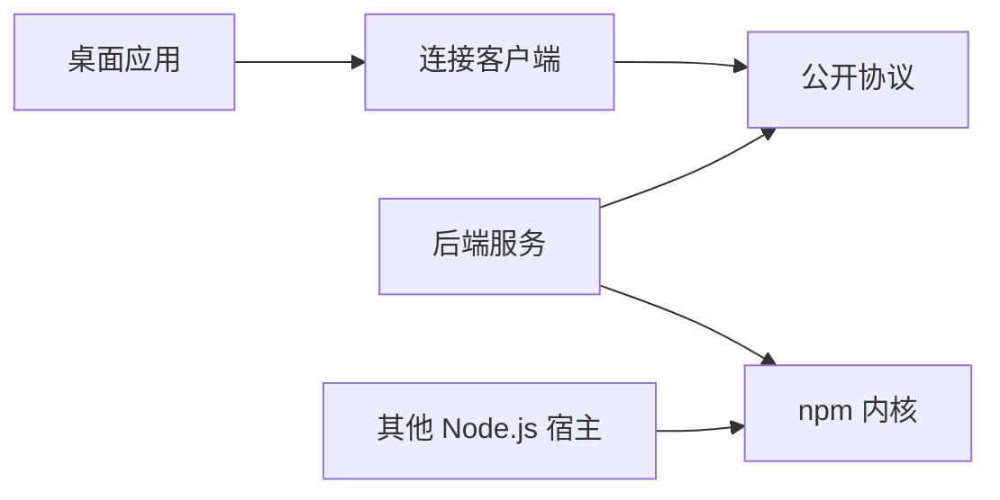

# 通用智能体运行时设计方案

状态：当前讨论正文；交付形态与 OpenCode 式分层已确认，拆包、API 和首批能力待确认。本轮仅更新方案。

更新日期：2026-11-20。

需求与验收见[需求文档](./需求文档.md)，跨轮次结论见[决策记录](./决策记录.md)。本文提炼自旧项目的[通用运行时设计](../../../../template-agent/.spaces/01.智能体/接口调用智能体/设计方案.md)，结合本项目历史 SDK 资料整理；后续讨论直接更新本文。

## 先看整体方向

目标是一个可通过 npm 安装、可配置的 Node.js 智能体核心：配置模型、提示词、工具、Skills、MCP 与子代理，再由同一套内核处理执行、动态委派、等待、提问与结果返回。产品只提供桌面应用和后端智能体服务，不做交互式 CLI／TUI，也不单独交付网页产品；其他 Node.js 宿主可直接调用核心。

已经明确的产品主线：

1. 每个 Agent 独立配置能力；同一个 Agent 能单独执行，也能被其他 Agent 作为子代理调用。
2. 子任务的种类与数量在执行时按需决定；初始化提供可用能力，不预先固定一整支团队。
3. 支持多个任务并行、等待依赖和结果汇总。
4. 信息不足时提出选项或文字问题，用户回答后继续原任务。
5. 桌面是产品界面；浏览器和本机桌面操作属于可选执行能力，不由产品界面决定。

当前最值得先确定的是首个真实任务、是否需要本机执行或离线运行、断线后承诺恢复到哪一步。框架、接口名称和默认限额随后随闭环确定。

## 现状与资料的适用范围

| 资料或对象                 | 核对结果                                                                 | 本轮如何使用                                                  |
| -------------------------- | ------------------------------------------------------------------------ | ------------------------------------------------------------- |
| 旧项目 2026-11-13 方案     | 明确产品目标，完整架构和选型仍待确认                                     | 提炼目标、取舍和问题；旧 API 只作草案参考。                   |
| 旧项目十课及验证           | 课程示例有隔离验证记录                                                   | 学习与控制流参考，不等于正式 SDK、真实业务或界面验收。        |
| 本项目 2026-11-14 SDK 资料 | 记录统一内核、本地及进程子代理、22 项测试和 3 个真实模型场景             | 保留为历史实现及证据，详见[交付记录](./交付记录.md)。         |
| 当前工作树                 | 2026-11-16 核对入口为 0 字节，原运行时源码和测试存在预存删除；包工程仍在 | 当前不能宣称历史 API 可用；保留现有代码改动，本次仅整理文档。 |

是否恢复历史实现、重新实现或采用框架尚未决定。本次没有重跑历史测试；外部源码对照的范围见 [Claude Code 与 OpenCode 的参考设计](#claude-code-与-opencode-的参考设计)。

## OpenCode 式分层

已确认采用 OpenCode 式分层。借鉴的是职责和依赖方向，不是照搬所有上游包或绑定它的框架。以下目录、存储和传输落点是建议，不是已实施的模块清单。



箭头表示代码依赖。桌面通过 `client` 发命令给 `server`，`server` 调用 `core`，客户端通过查询或 SSE 获取状态；`protocol` 定义双方说什么，不负责转发或运行。`core` 不依赖 HTTP 协议，`client` 不导入 `core` 或 `server`。

| 层         | 负责什么                                                                                                                               | 本项目建议落点                                                                                                        |
| ---------- | -------------------------------------------------------------------------------------------------------------------------------------- | --------------------------------------------------------------------------------------------------------------------- |
| `core`     | Agent 定义、运行状态机、模型适配接口、统一工具管线、上下文、子任务、取消和领域事件；通过接口使用存储与授权策略。                       | 以 `packages/agent` 为可安装 npm 包的工程基线。模型适配、工具执行器可先作为内部模块或由宿主注入；直接调用不监听端口。 |
| `protocol` | 定义跨进程的命令、公开会话／run／消息片段／交互状态、事件和错误；不包含凭证、工具执行函数或 Provider 私有结构。                        | 可先放在现有 `packages/shared` 的独立入口，供两端使用且不引入 Node.js 专属依赖；不等于单独发布 npm 包。               |
| `server`   | 管理用户身份、作用域、凭证和业务授权；持有运行协调、持久化适配及对外查询，不再实现第二套运行状态机；将内核事件转换为可对外公开的数据。 | 可由现有 `apps/server` 的 NestJS 模块承接。启动任务和订阅进度分开；取消订阅不取消 run。                               |
| `client`   | 发送命令、订阅事件、重连和刷新权威状态，处理临时增量，不承担权限决策或执行循环。                                                       | 先作为桌面应用的独立连接模块，有第二个复用方再决定是否抽包。                                                          |
| `desktop`  | 展示会话、文本和工具进度、待答问题或审批；提交用户选择和取消指令。                                                                     | 独立应用，桌面框架和是否附带本机服务均待确认。渲染界面不持有模型凭证。                                                |

上游依赖可对照 [core](https://github.com/anomalyco/opencode/blob/88c90d08add7dd899a0caefc15609fdbb1d4b2ed/packages/core/package.json#L101-L126)、[protocol](https://github.com/anomalyco/opencode/blob/88c90d08add7dd899a0caefc15609fdbb1d4b2ed/packages/protocol/package.json#L18-L34)、[server](https://github.com/anomalyco/opencode/blob/88c90d08add7dd899a0caefc15609fdbb1d4b2ed/packages/server/package.json#L29-L43)与 [client](https://github.com/anomalyco/opencode/blob/88c90d08add7dd899a0caefc15609fdbb1d4b2ed/packages/client/package.json#L18-L41)。上游另有 `schema`、`ai` 和嵌入式 `sdk` 等包；本项目先保留清晰边界，不按其包数发布。

核心保持通用；宿主将本项目的用户、企业、项目等业务信息转换为运行上下文。模型与工具凭证留在可信 Node.js 环境，前端消费可公开的数据。

## 统一初始化与对象生命周期

以下名称用于解释职责，尚未定为导出类型。

| 对象       | 内容与生命周期                                                                                        |
| ---------- | ----------------------------------------------------------------------------------------------------- |
| Agent 定义 | 标识、描述、提示词、模型、工具、Skills、MCP、子代理能力和限额；描述能力，不保存某用户的会话。         |
| Agent 实例 | 从定义解析得到可复用的运行对象，持有模型客户端和资源句柄；独立运行与子代理调用共用它。                |
| 会话       | 某用户及作用域下的对话历史；同实例可服务多个隔离会话，暂以 `session` 称呼，旧稿 `thread` 指同一概念。 |
| Run        | 一次执行，包含输入、身份、状态、预算、取消、结果及父子关联；回答问题继续这个 run。                    |
| 子任务句柄 | 一次委派的可查询标识，关联子 run、依赖与结果；不等于初始化一个永久 Agent。                            |

配置与运行参数分开：模型、工具和可用模板属于实例能力；用户身份、会话、任务输入、父运行和取消信号属于运行上下文。

建议每次运行固定定义版本，执行工具时重新校验当前权限。关闭实例只释放它拥有的资源，借入实例与共享连接按明确所有权处理；取消一个 run 不应破坏同实例处理的其他任务。

## 模型、工具、Skills 与 MCP

| 能力          | 对外行为                                                                     | 首批需确认                                                                                       |
| ------------- | ---------------------------------------------------------------------------- | ------------------------------------------------------------------------------------------------ |
| 模型适配      | OpenAI、Anthropic 协议分别配置；主备模型只接管当前请求，保留已完成工具结果。 | 支持的服务、故障分类、重试次数；已经流出部分内容后的切换策略。                                   |
| Function 工具 | 统一名称、描述、输入校验、结果、超时和取消；实际执行经过授权。               | 输出大小、错误类型、结构化最终结果是否首批。                                                     |
| Skills        | 先发现名称与描述，再按需读正文及允许引用的文件，提供流程与知识。             | 目录规范、兼容范围、随附脚本如何通过授权工具执行。                                               |
| MCP           | 发现并过滤工具后纳入统一目录，保留来源和命名空间，管理连接与关闭。           | 本地 stdio、远程 HTTP 哪些先做；认证与协议版本实施前核验，工具接入不自动承诺 prompts/resources。 |

Skills、MCP 和本地工具汇入一致的执行与权限路径。读取技能内容不扩大权限；工具出错、无权限与模型服务故障分别处理。已有副作用不能因切换模型或恢复任务而重新执行。

## 模型多协议接入与工厂职责

状态：2026-11-16 的源码核验与建议草案。本节讨论多协议接入、思考配置和上下文管理；字段、导出名称、适配依赖和首批范围均未确认，不是当前可调用 API。

### OpenCode 参考实现

本次核验官方仓库提交 `f4107529f62fce84bd89fb9576714916b1d8a229`，不沿用前文历史提交作为本次源码依据。以下为结构摘要：

1. 用 Provider ID 选择连接配置；凭证、地址和连接设置随该 Provider 解析，再合并模型及 variant 设置。
2. 通过 `Provider.loadPackage()` 从内置加载器或模块加载适配包；统一调用包的 `model(modelID, settings)`，返回统一的 `LanguageModel`。
3. 原生 OpenAI 包用 `configure()` 创建连接配置和路由，默认 `model()` 走 Responses；显式 Chat 入口走 Chat Completions。Anthropic 包同样经 `configure()` 创建模型对象。
4. 因此，多协议通过多个适配包与 Provider 配置表达；一次调用最终确定一个 Provider、模型和接口路由。工厂负责创建模型对象，运行内核消费统一模型能力。
5. 模型解析结果还携带模型目录能力、上下文限额和价格信息；variant 在模型设置之上叠加调用选项。官方模型文档进一步区分 reasoning 的开关、强度与 token 额度，具名 variant 可表达不同预设，不能假定所有模型都支持相同档位。
6. 上下文管理使用模型限额；官方另有 compaction 策略，配置自动压缩、保留近期内容和空余窗口。模型容量与应用压缩策略分别管理，不等同于一个请求参数。

官方当前迁移文档还区分旧版 `provider / npm / options` 与新版 `providers / package / settings`。本项目借鉴职责，不直接复制任一版本的配置字段。

核验来源（仅用于理解外部实现，不代表采用其依赖）：[模型解析源码](https://github.com/anomalyco/opencode/blob/f4107529f62fce84bd89fb9576714916b1d8a229/packages/core/src/model-resolver.ts)、[适配包加载源码](https://github.com/anomalyco/opencode/blob/f4107529f62fce84bd89fb9576714916b1d8a229/packages/core/src/provider.ts)、[OpenAI 原生适配](https://github.com/anomalyco/opencode/blob/f4107529f62fce84bd89fb9576714916b1d8a229/packages/ai/src/providers/openai.ts)、[Anthropic 原生适配](https://github.com/anomalyco/opencode/blob/f4107529f62fce84bd89fb9576714916b1d8a229/packages/ai/src/providers/anthropic.ts)、[V1 配置迁移说明](https://opencode.ai/docs/migrate-v1/)。固定提交用于追溯，迁移页面可能继续更新。

思考与上下文补充来源：[模型目录源码](https://github.com/anomalyco/opencode/blob/f4107529f62fce84bd89fb9576714916b1d8a229/packages/core/src/model.ts)、[官方 Models 文档](https://opencode.ai/docs/models/)、[官方 Compaction 文档](https://opencode.ai/docs/compaction/)。在线文档于 2026-11-16 查阅，页面会继续更新；此处仅摘要职责，不复制其默认容量、预算或参数契约。

### 本项目建议：注册表、连接配置与模型引用分开

| 对象              | 示例                                                    | 负责什么                                                                     |
| ----------------- | ------------------------------------------------------- | ---------------------------------------------------------------------------- |
| 协议适配器        | `openai-chat`、`openai-responses`、`anthropic-messages` | 处理对应接口的消息、工具、流式事件与错误转换，向内核提供统一能力。           |
| Provider 连接配置 | `gatewayChat`、`gatewayMessages`                        | 为一个具名连接指定协议、地址、凭证引用和连接选项；同协议可有多个连接。       |
| 模型引用          | `{ providerId, modelId }`                               | Agent 的主模型、备用模型分别引用已配置连接和实际模型；模型名不用于猜测协议。 |

建议运行时持有协议工厂注册表和 Provider 连接注册表。协议工厂由宿主显式注册或使用内置实现，连接配置一次传入；Agent 只引用需要的模型。Agent 初始化工厂与模型工厂职责分开，子代理可以复用同一注册表并选择不同模型。

连接与选择的配置草案如下；这里只展示多协议传参入口，完整模型能力与调用设置见下一小节。模型名和地址均为示意，环境变量名仅表示凭证引用：

```ts
const config = {
  providers: {
    gatewayChat: {
      protocol: 'openai-chat',
      baseURL: 'https://gateway.example/v1',
      apiKey: { env: 'GATEWAY_CHAT_API_KEY' },
    },
    gatewayMessages: {
      protocol: 'anthropic-messages',
      baseURL: 'https://gateway.example',
      apiKey: { env: 'GATEWAY_MESSAGES_API_KEY' },
    },
  },
  agents: {
    main: {
      model: { providerId: 'gatewayChat', modelId: 'chat-model-a' },
      fallbackModels: [{ providerId: 'gatewayMessages', modelId: 'messages-model-b' }],
    },
    research: {
      model: { providerId: 'gatewayMessages', modelId: 'messages-model-b' },
    },
  },
}
```

协议控制入口的示意如下。工厂输入、返回接口及命名仍待契约确认：

```ts
const adapterFactories = {
  'openai-chat': createOpenAIChatAdapter,
  'openai-responses': createOpenAIResponsesAdapter,
  'anthropic-messages': createAnthropicMessagesAdapter,
}

/** 根据已校验的连接配置创建协议客户端；凭证由可信宿主解析。 */
function createProvider(providerConfig) {
  const factory = adapterFactories[providerConfig.protocol]
  if (!factory) throw new Error('不支持的模型协议')
  return factory(providerConfig)
}
```

调用路径建议为：Agent 模型引用 → 连接注册表 → 对应协议客户端 → 指定模型 → 统一调用循环。Provider 客户端按可信宿主、配置版本和凭证作用域复用；模型对象的缓存粒度由适配器约定，不能只按协议全局共享而混用地址或身份。

### 模型定义、调用参数与上下文管理

用户已明确补充思考强度、上下文大小属于模型配置讨论范围。下列分层、字段和预设仍是本项目建议；模型声明和配置不会自动改变服务端能力，也不表示首批实现自动摘要。

| 层次           | 建议内容                                                                                                 | 归属与作用                                                             |
| -------------- | -------------------------------------------------------------------------------------------------------- | ---------------------------------------------------------------------- |
| 协议适配       | 消息、工具、流式、错误、用量及专属参数转换                                                               | 适配器注册表；决定怎样调用接口。                                       |
| 连接           | Provider ID、协议、地址、凭证引用、连接超时与受控请求头                                                  | 可信宿主；决定调用哪条连接。                                           |
| 模型定义       | 模型 ID／服务端 ID、实际上下文窗口、最大输入／输出、工具、模态、结构化输出、采样与思考能力；可选价格信息 | 模型目录，按具体连接和模型声明；记录来源及核验状态，不能仅凭协议推断。 |
| 调用参数与预设 | 思考模式／强度／额度、最大输出、温度等受支持采样项、协议专属选项；可选 fast／deep 具名预设               | 模型默认值及 Agent／本次请求选择；预设是同一模型的参数组合。           |
| 上下文策略     | 应用输入上限、输出及安全余量预留、压缩触发和近期内容保留                                                 | 运行内核；决定本次送多少内容，超限时如何处理。                         |
| 执行预算       | 请求与整棵任务树的累计 token、费用、模型调用次数和截止时间                                               | 运行调度；约束整个任务消耗，与单次窗口容量分开。                       |

思考配置建议按能力区分开关、强度和 token 额度，不预设所有模型都接受统一 `low / medium / high`。具体模型可能只支持一种控制，也可能支持组合或存在互斥条件；适配器负责映射，模型能力负责验证。思考强度不是精确 token 数，服务返回的公开思考摘要也不等于完整内部推理。

建议在已配置 Provider 下维护具名模型定义；Agent 选择 `{ providerId, modelId, variant? }` 并按授权范围覆盖调用参数。以下仅说明层次，模型名、能力与所有数值均为虚构示意，不代表任何实际服务或本项目默认值：

```ts
// 位于 providers.gatewayChat.models['chat-model-a'] 的模型定义。
const modelDefinition = {
  limits: { contextTokens: 128000, inputTokens: 120000, outputTokens: 8192 },
  capabilities: {
    tools: true,
    input: ['text'],
    output: ['text'],
    reasoning: { supported: true, effort: ['low', 'medium', 'high'] },
  },
  defaults: { reasoning: { effort: 'medium' }, maxOutputTokens: 4096 },
  variants: {
    fast: { reasoning: { effort: 'low' } },
    deep: { reasoning: { effort: 'high' } },
  },
}

const agentModel = {
  providerId: 'gatewayChat',
  modelId: 'chat-model-a',
  variant: 'deep',
  options: { maxOutputTokens: 4096 },
}

const contextPolicy = {
  maxInputTokens: 90000,
  overflow: 'error', // 自动压缩确认且启用后，才可选择对应策略。
}
```

建议的参数解析顺序是：适配器默认值 → 已校验的模型默认值 → 选定 variant → Agent 覆盖 → 本次调用覆盖；只覆盖允许修改的字段。模型能力、凭证、宿主授权及祖先预算是校验约束，不能被后级参数覆盖。未指定的字段保留默认，数组及互斥思考配置如何替换需在契约确认，不能对所有对象无差别深合并。

工厂与调用过程进一步分工：

1. Provider 工厂按连接配置创建或复用协议客户端，保持连接身份和配置版本隔离。
2. 模型解析器读取模型定义、选择预设、合并调用选项，验证思考及输出参数，再产出本次请求使用的不可变设置；不通过修改共享客户端来切换思考强度。
3. 运行内核根据当前模型限额检查输入、输出预留与任务预算，准备上下文；适配器把已验证的请求转换成对应协议格式。

请求级参数只要会被模型对象捕获，就必须纳入该对象的缓存标识，或每次请求单独绑定；同一连接和模型的 fast／deep 请求并发时不得互相污染。

上下文与预算建议遵循以下边界：

- 模型上下文窗口是实际服务容量的声明；填写更大的数字不会扩容。实际限制可能受部署或网关影响，应记录可核验来源；未知时明确标记，不宣称已经探测。
- 在共享输入／输出窗口的模型上，建议输入预算不超过 `min(模型最大输入, 应用输入上限, 模型窗口 - 输出预留 - 安全余量)`；若服务使用不同计量规则，由适配器声明。估算须计入系统提示词、工具定义、历史、工具结果及附件，不能只统计用户文字。
- 最大输出、思考额度和最终可见文字长度分别表达。内部思考是否计入输出上限与用量依具体接口处理，避免漏计或重复计数；token 估算不能作为精确计费承诺。
- 压缩阈值与保留近期内容属于应用策略。容量校验不依赖自动摘要已实现；未启用压缩时明确报超限，启用后也需保留任务约束及工具调用／结果配对，并重新校验摘要请求和最终请求。
- 整树累计预算不随每轮请求、切换模型或上下文压缩重置；若启用摘要，其模型请求与用量也计入预算。价格信息仅用于估算，不保证精确限制服务端计费。
- 主模型与各备用模型分别选择预设和参数；切换后重新解析能力、消息兼容及窗口，不能把主模型思考档位、token 额度或压缩状态直接透传给另一模型。

自动压缩、精确计数工具、具名预设、费用预算及能力目录自动发现是否首批，仍待讨论；本节没有改变需求中的 P0／P1 分批状态。

### 多协议传参和主备切换的边界

- 一次传入多个具名 Provider 配置，每条配置明确自己的协议；同一个网关暴露多个协议时可以登记多条连接。
- 主模型和每个备用模型各自携带 Provider 与模型引用，因此允许跨协议选择；注册多协议不自动启用故障切换。
- 切换前核对消息、工具调用、结构化输出、图片与流式能力，以及思考参数、输入／输出和上下文限制是否满足当前任务，沿用已有工具结果；部分输出如何交付仍待讨论。
- Chat Completions 与 Responses 分别选择路由，不根据模型名、地址或某次报错自动猜测协议；地址拼接和认证规则归对应适配器。
- 首批是否实现全部三种适配器、是否开放自定义适配器、外部模块加载方式及统一能力接口，均未决定。

## 动态子代理的两个层次

“按需创建子任务”是明确目标；“模型可以现场定义到什么程度”仍需讨论。

| 层次                                | 示例                                                        | 状态与建议                                       |
| ----------------------------------- | ----------------------------------------------------------- | ------------------------------------------------ |
| 已登记 Agent 或模板，运行时决定数量 | 登记检索能力，需要时启动两个检索子 run，再交给汇总 Agent。  | 满足动态数量目标，建议作为首个编排闭环，待确认。 |
| 在允许能力内临时组合角色            | 模型选择已授权模型、工具和 Skills，给临时角色写任务提示词。 | 更高自由度；允许覆盖哪些字段、如何审计待确认。   |

实际创建由运行时校验可用能力、祖先权限、深度、并发与整树预算。模型提出任务不等于获得新增凭证、任意工具或进程启动权。

子任务默认只接收明确传入的输入和必要上下文。父子关系属于一次运行，Agent 实例不永久绑定父实例。建议用子任务句柄读取结果、等待一个或多个任务、取消子任务；代理之间的直接消息另行讨论。

## 等待、并行与依赖

需要支持两类情况：开始时已知 A、B 完成后由 C 汇总；执行到中途才发现需要等待另一任务的结果。

建议运行时显式记录依赖关系，在结果到达时唤醒等待者。区分委派层级和结果依赖，防止互相等待形成环。等待不靠模型反复查询，也不持续占用活跃执行或模型并发名额。

历史实现的 `context.delegate()` 配合 `Promise.all` 只证明当时代码可显式并行委派，不能证明已实现模型可创建、查询、等待、续接的完整任务系统。后续任务句柄、失败传播与依赖恢复需要单独设计和验收。

子任务是否允许脱离父 run 长期运行、失败时其他分支继续还是取消、结果保留多久，均未确定。建议首个闭环先保持可追踪的父子任务树。

## 执行中提问与原任务续接

这是既有首期目标。问题可以来自主代理或子代理，由宿主统一展示；答案可以是候选项或自由文本。

建议运行态区分排队、执行、等待子任务和等待用户；业务需要批准操作时，可扩展独立的等待审批状态，是否纳入首批另行确认。终态与超时、取消、依赖失败的完整转移，在契约确认后定义。用户补充信息与操作批准分别处理，不能因为回答了问题就批准业务写入。

建议的完整交互流程：

1. 记录问题与所属用户、会话、run、父子任务关系，将对应执行路径置为等待状态。
2. 通过事件和可查询快照把控制交回宿主，避免界面只拿到一个永不结束的阻塞请求。
3. 回答时校验归属、有效期、问题状态及权限；答案只消费一次，不默认代选。
4. 恢复同一 run，沿用历史、工具结果与剩余预算；其他无依赖任务可以继续。

观察进度、回答问题和取消任务定位同一次执行，不能为订阅事件或续接而重复启动 run。

## 恢复与执行位置

| 恢复层次     | 需要承诺的行为                                       | 影响                                                           |
| ------------ | ---------------------------------------------------- | -------------------------------------------------------------- |
| 进程内续接   | 运行进程仍在时，能回答问题并继续任务。               | 可先用内存状态，仍需明确 run、问题和预算的所有权。             |
| 界面断线重连 | 关闭桌面窗口或连接断开后，可查询同一任务并重新订阅。 | 稳定标识、状态快照、事件去重或补发；断线不等于取消。           |
| 服务重启恢复 | 进程重启后仍能找回任务、问题和依赖并继续。           | 持久状态、检查点、执行结果与幂等；结果未知的工具不能自动重放。 |

本次尚未选定恢复层次。独立 Node.js 子进程只是一种执行方式，不自动提供持久恢复或安全隔离。

建议先让桌面连接后端，同一次运行由后端拥有，不随窗口开关结束。仅在首个任务必须访问本机资源时增加经授权的本地执行器；必须离线运行内核时再考虑同机服务。两种执行位置共用协议，不在桌面重写运行循环。若采用同机服务，须单独处理启动就绪、版本检查、单实例、凭证和退出时的资源归属；进程独立不是安全隔离，离线还要求模型和必要工具在无网络时可用。首批执行位置待确认。

## 事件、限额与权限的共同原则

- 事件表达公开文本、任务状态、工具开始结束、子任务、待答问题、用量与结果，不以暴露模型内部推理为目标。
- 整树计算模型尝试、工具执行、子任务数、深度、token 与截止限制，子任务不能重置祖先预算。
- 区分执行超时、用户等待期限和累计等待限制；回答不重置预算，计时与默认值待确认。
- 等待用户或子任务时释放活跃执行名额；模型请求、工具执行与后台资源的并发分别管理。
- 实际执行检查当前身份与作用域；工具白名单、路径限制和独立进程不等于操作系统级隔离。
- 取消阻止后续执行并尽力释放资源，不能撤销已有远端副作用；凭证、原始异常和敏感结果不直接进入公开事件。

## Claude Code 与 OpenCode 的参考设计

OpenCode 固定在 GitHub 上游提交 [`88c90d08`](https://github.com/anomalyco/opencode/tree/88c90d08add7dd899a0caefc15609fdbb1d4b2ed)，其分层已确认采用，未选定引擎或新增依赖。Claude Code 以用户指定的本机 `C:/malei/stu/stu-ai/claude-code/md/Claude-Code-Source-Study` 为研读入口；关键机制对照同仓 `claude-code/source` 的非官方 source map 还原树（本地提交 `06eaba265`）。`999.0.0-restored` 是还原标识，不是官方发行版本；研究笔记的许可不等于还原源码的许可，不复制或依赖其源码。

### OpenCode 的服务与连接

- [进程内 SDK](https://github.com/anomalyco/opencode/blob/88c90d08add7dd899a0caefc15609fdbb1d4b2ed/packages/sdk/README.md#L3-L16)与 [HTTP 客户端](https://github.com/anomalyco/opencode/blob/88c90d08add7dd899a0caefc15609fdbb1d4b2ed/packages/client/README.md#L3-L10)分开。上游 SDK 在进程内复用服务路由；本项目的 Node.js 调用方建议直接使用内核，不内置 HTTP 路由。
- [桌面主进程可启动兼容的后台服务](https://github.com/anomalyco/opencode/blob/88c90d08add7dd899a0caefc15609fdbb1d4b2ed/packages/desktop/src/main/service/background-service.ts#L29-L76)，[界面通过同一客户端连接](https://github.com/anomalyco/opencode/blob/88c90d08add7dd899a0caefc15609fdbb1d4b2ed/packages/app/src/runtime/server/api.ts#L25-L38)。本项目建议先让桌面连接后端，按本机能力需求再决定是否要同机服务，不移植无关的 CLI 包装。
- [全局 SSE 只推实时通知](https://github.com/anomalyco/opencode/blob/88c90d08add7dd899a0caefc15609fdbb1d4b2ed/packages/protocol/src/groups/event.ts#L59-L70)，桌面[重连再查状态](https://github.com/anomalyco/opencode/blob/88c90d08add7dd899a0caefc15609fdbb1d4b2ed/packages/app/src/runtime/server/sync.tsx#L104-L121)；另有[按游标回放的实验性会话日志接口](https://github.com/anomalyco/opencode/blob/88c90d08add7dd899a0caefc15609fdbb1d4b2ed/packages/protocol/src/groups/session.ts#L659-L674)。本项目可先用状态查询加实时通知，是否提供耐久事件补发另行确定。

### Claude Code 笔记里的可迁移机制

下表篇目来自本机 `Claude-Code-Source-Study/docs/`。这些是可用来设计自家模块的机制，不是 Claude 的官方接口承诺，也不是新的实施批次。

| 笔记                                                                                                        | 落到哪一层                                | 借什么，不照搬什么                                                                                                                                                                                                                                                                              |
| ----------------------------------------------------------------------------------------------------------- | ----------------------------------------- | ----------------------------------------------------------------------------------------------------------------------------------------------------------------------------------------------------------------------------------------------------------------------------------------------- |
| 05「对话循环」`364`、`401`、`540`；20「API 调用与错误恢复」`217`                                            | `core` + `protocol` + `client`            | 按模型轮次组织调用、工具回填与停止原因。文字可以边生成边显示，工具先等整轮输出完毕、参数完整并获授权再执行。重试当前模型请求与重跑任务分开；若已发出部分文字，用尝试标识关联草稿并替换或撤回，不把单次重试显示为最终失败。显式取消传播到模型和工具，断开订阅不等于取消。                        |
| 04「System Prompt 工程」`191`；07「Prompt Cache」`181`、`705`；08「Thinking 与推理控制」`107`               | `core` 的提示词构造与模型适配             | 固定规则和工具定义保持稳定，用户、工作区及任务内容按作用域后置组装。模型窗口、推理参数、缓存指令由各 Provider 适配，不把 Anthropic 的缓存字段、推理内容或具体开关写进通用公开协议；私有上下文不得作为跨用户缓存。                                                                               |
| 06「上下文管理」`43`、`383`；23「Memory 系统」`636`                                                         | `core` 的上下文模块 + `server` 的存储适配 | 会话原始记录、给模型的有限工作上下文和跨会话记忆分开；先预留输出预算、限制旧工具结果，再按需摘要。压缩保留工具调用与结果的配对，调用模型前仍需校验预算。待答问题和已执行工具的状态不靠摘要恢复；不照搬固定阈值或默认自动记忆。                                                                  |
| 09「工具系统设计」`376`、`441`；16「权限系统」`276`；17「Settings 系统」`723`；18「Hooks 系统」`563`、`633` | `core` 的工具管线 + `server` 的策略       | 分开注册、给模型看的工具集和实际执行授权。可信 hooks 可变换输入或否决，不得给工具提权；最终参数重新校验并授权。审批一次只针对指定 run、工具调用及所批准的资源或参数；无人处理时不自动批准。默认未知工具不可并发，不照搬终端渲染方法、自动信任或仓库脚本 hooks。                                 |
| 15「MCP 协议实现」`627`、`952`；24「Skill/Plugin 开发实战」`114`、`131`                                     | `core` 的能力适配                         | MCP 是来源明确的工具适配器，用命名域消除重名，沿用本地工具的执行授权和取消。Skill 用名称、描述供发现，正文按需加载，不能因加载而取得额外工具权限。优先保留显式加载与可信来源，不默认拉起任意本机程序或执行 Skill 文档内的命令。                                                                 |
| 12「Agent 系统」`383`、`533`、`964`；13「内置 Agent 设计模式」`658`；14「任务系统」`395`                    | `core` 的委派 + `server` 的协调           | 用角色模板配置提示词和工具范围，不为检索、规划、验证另造运行引擎。子代理共享受控适配器和整树预算，不共享可变历史或越权工具；保存父子 run 和结果，父取消向下传播。恢复重读已确认历史，不等于恢复旧进程；副作用结果未知时不自动做第二次。运行中的追加指令先排队，在轮次边界接纳，不改写在途请求。 |

运行时显式接收身份、工作区、会话及取消信号，不依赖全局会话或工作目录；运行定义可固定版本，但执行工具前仍需检查最新权限。终端 UI、编译开关、编码工具全集和复杂插件体系不是通用 npm 内核的前提。

建议先用单 Agent、一个模型接入和一个只读工具验收首个闭环：后端记录输入、创建 run 并返回标识，模型在独立运行流程里处理；执行中发出澄清问题；关窗重连能查到同一个待答问题，回答后继续原 run。用权威状态查询恢复历史与待交互状态，文字增量不要求逐条补发。其他协议、动态编排和执行器继续按既有目标讨论，不视为取消。

## 引擎与历史实现参考

引擎尚未定案。旧教程中的 LangChain / LangGraph 是学习方案，本项目历史原生 Node.js + Zod 内核是一份实现参考；此前框架比选不作为本轮已经核验的推荐结论。需要比较时，再根据选定闭环核验依赖、能力和维护成本。

历史实现参考如下，详细 API 见[历史技术契约](./技术契约.md)：

- `AgentHost` 管理模型并发和资源，`bootstrapAgent()` 统一初始化主代理、同进程子代理和独立进程代理。
- 实例持有定义与 session；run 持有身份、取消和预算。历史实现采用 AsyncLocalStorage 隔离异步身份。
- 工具执行和等待子代理前释放模型名额；备用模型只续处理当前请求。
- 进程通过可信模块工厂重建客户端，父级协调跨进程预算、授权与事件；自有和借入资源分别释放。
- 历史实现曾参考 OpenCode commit `f0089856c07eded13396a0a0d05f19f1718be7b9` 及本地 Claude Code 还原源码；本轮只针对桌面、服务与内核切分重新对照上节列出的源码。

旧草案 `createAgentRuntime()` 与历史 SDK `bootstrapAgent()` 不并列定义为当前公开接口。先明确初始化、执行、订阅、提问续接、子任务与释放的语义，再统一名称和类型。

## 建议的讨论顺序与验收闭环

| 顺序 | 先讨论什么                                     | 建议产出                                                           |
| ---- | ---------------------------------------------- | ------------------------------------------------------------------ |
| 1    | 第一个桌面任务完成什么，是否需要本机或离线执行 | 具体输入、允许动作、需要提问的信息、最终结果和执行位置。           |
| 2    | 需要多大的自主委派能力                         | 首批 Agent / 模板、动态数量、输入输出和失败策略。                  |
| 3    | 任务持续到什么程度                             | 进程内续接、断线重连、服务重启恢复的选择。                         |
| 4    | 哪些能力分批完成                               | 工具循环、Skills / MCP、提问、动态编排、界面和执行器的依赖及验收。 |
| 5    | 采用什么引擎和契约                             | 更新[技术契约](./技术契约.md)后进入实现。                          |

建议用一个包含完整行为的任务检验方案：主代理接收任务，信息不足时提问，得到回答后按需创建两个子任务，等待结果，再调用汇总能力返回答案。业务、模型、工具和是否包含实际写操作，尚待用户指定。

验收至少区分同一 run 续接、成功工具不重放、低并发不死锁、父取消传播、其他独立任务不受影响、重复或越权答案被拒绝。模拟验证和真实外部闭环分别记录。

## 变更记录

| 日期       | 摘要                                                           | 原因与影响                                                                                                                       |
| ---------- | -------------------------------------------------------------- | -------------------------------------------------------------------------------------------------------------------------------- |
| 2026-11-20 | 确认 OpenCode 式分层，以指定笔记补充 Claude Code 机制          | 明确五层依赖与职责；新增流式失败处理、模型缓存边界、工具授权、能力来源与子代理隔离等设计建议，不锁定包结构或实施批次。           |
| 2026-11-19 | 对照 Claude Code 与 OpenCode，更新桌面／后端／npm 核心边界     | 用户明确不做 CLI 界面；记录服务连接、事件与重连、工具授权和上下文建议，不确认实现、端点或首批本机执行。                          |
| 2026-11-14 | 记录原生 SDK 统一内核与本机进程设计                            | 当时作为核心实施依据，本轮转为历史参考，证据保留。                                                                               |
| 2026-11-16 | 补充模型能力、思考预设、调用覆盖、上下文策略与任务预算分层     | 用户明确模型接入还包含思考强度与上下文大小；核验 OpenCode 模型及压缩职责，记录建议及工厂边界，不确认字段、默认值或新增实施批次。 |
| 2026-11-16 | 核验 OpenCode 接入结构，补充协议工厂、连接注册表与模型引用草案 | 回答多协议如何选择和传递；区分外部实现与本项目建议，未选定依赖、公开 API 或首批范围。                                            |
| 2026-11-16 | 在原文档整理完整 Agent 方案、现状差异与讨论顺序                | 用户要求在本项目继续讨论；统一旧方案目标与本项目资料，技术与首批范围待确认。                                                     |
