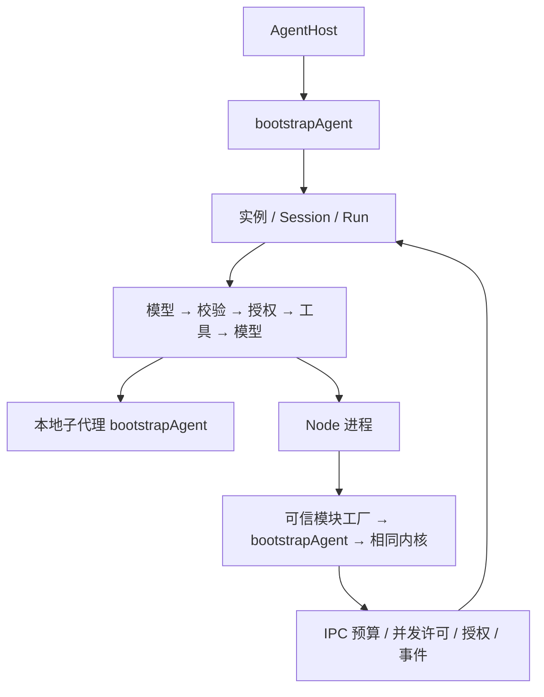

# Node.js 智能体 SDK 设计方案

状态：当前有效；本轮核心实施依据。日期：2026-11-14。

## 参考与取舍

- OpenCode commit `f0089856c07eded13396a0a0d05f19f1718be7b9` 的 `packages/core/src/instance.ts`、`tool/plugin/subagent.ts`、`session/subagent-job.ts`：借鉴实例组装、子会话关联与统一内核，不引入其 Bun／Effect 环境。
- 本地 `C:/malei/stu/stu-ai/claude-code/source` 的 `utils/agentContext.ts`、`utils/forkedAgent.ts`、`tools/AgentTool/runAgent.ts`：借鉴 AsyncLocalStorage、可变上下文隔离与复用 query。该目录为 source-map 还原树，仅参考结构。
- Node.js 原生 fetch、child_process 和 AsyncLocalStorage，Zod 负责参数与 JSON Schema，可注入 ModelAdapter 以确定性测试。

## 统一内核

AgentHost 管理实例和模型并发，bootstrapAgent 是唯一实例工厂。实例持有不可变定义与 session 历史，run 持有身份和信号，每个根 run 建立预算协调器。祖先授权与子代理授权取交集。

仅模型请求占并发名额，执行工具或等待子代理前释放；防止父任务等待导致死锁。工具默认顺序执行，业务工具可通过 context.delegate 和 Promise.all 显式并行委派。备用模型只重发当前请求并携带已有工具结果。

同 session 顺序执行，超时自提交开始，只有成功运行原子提交历史；子代理默认新 session，仅获得明确输入。独立根运行的取消和预算互不影响。token 预算响应后按服务端报告核算，不承诺精确限制远端计费。

## 进程与资源

进程描述仅含可信模块绝对路径／file URL、导出工厂名、JSON 配置。worker 继承宿主环境，在工厂内读取凭证并重建客户端。环境继承不是凭证隔离或操作系统沙箱。

每个进程实例按需启动一个复用 worker。IPC 传运行描述、业务消息、预算与授权请求、事件和结果；整树预算和祖先授权始终由上级协调，不能跨进程重置。取消发送给 worker，关闭最终终止自有进程；worker 异常退出时当前运行失败，后续可重建。

实例只关闭自己初始化的子代理，不关闭借入实例。host 关闭全部自有实例。初始化期间收到关闭也应回收资源。事件默认不携带密钥、工具输入输出或底层异常正文，业务展示和脱敏由宿主决定。

## 目录与边界

按 core、model、tools、process、runtime 职责分目录。内部类型留在 agent 包；未来宿主前后端 DTO 归 shared，浏览器不得导入含凭证的运行时。具体 API 见[技术契约](./技术契约.md)。

本批不实现 MCP、Skills、交互挂起恢复、后台 DAG 队列、持久化与 token 增量流。测试结论以[交付记录](./交付记录.md)与后续测试报告为准。

## 变更记录

| 日期       | 摘要                                     | 原因                         |
| ---------- | ---------------------------------------- | ---------------------------- |
| 2026-11-14 | 基础工程方案转为统一运行时与本机进程设计 | 用户授权实施并提供真实模型。 |
